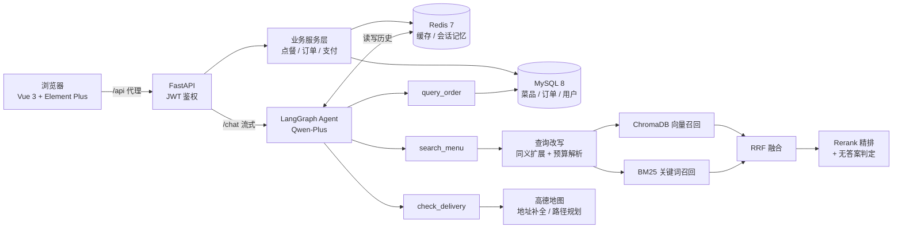

# AiMenu 智能点餐系统 (AiMenu Smart Ordering System)

[](https://www.python.org/)
[](https://vuejs.org/)
[](https://www.docker.com/)
[](LICENSE)

AiMenu 是一个可本地运行的全栈 AI 点餐项目：FastAPI 提供业务接口，LangGraph 编排工具调用型 Agent，
ChromaDB + BM25 + Rerank 完成菜品检索，高德地图负责配送范围校验，Vue 3 + Element Plus 提供点餐界面。


> 真实录屏（未加速）：一次「有什么清淡不辣的汤推荐」的流式对话，被推荐菜品在左侧标注「推荐」徽标，可直接加购；
> 同一场景的静态截图见 `screenshots/chat.png`。
> 下方检索指标由 `scripts/eval_rag.py` 在 153 道菜的本地模拟语料、150 条标注上实测，可复现，不代表线上规模效果。

---

## 核心能力

- **工具调用型 Agent**：基于 LangGraph 构建「决策 → 调用工具 → 生成回复」循环，接入菜单检索、配送校验、订单查询三类工具，支持 SSE 流式输出与多轮上下文。
- **会话记忆持久化**：多轮历史写入 Redis（按 `session_id` 分键、滑动 TTL），服务重启或换实例后仍能续上上下文，不再依赖进程内 `MemorySaver`。
- **混合检索**：向量召回（text-embedding-v4）+ BM25 关键词召回，RRF 合并去重后精排——默认 DashScope qwen3-vl-rerank，也可切到本地 `bge-reranker-v2-m3`（免额度、可离线复现）；Rerank 不可用时自动降级为融合结果。
- **口语化查询改写**：无菜名、偏口语的 query（"广式烧腊里的甜口猪肉"）先做同义扩展兜底召回；"四十块以内"这类预算约束会解析成价格区间并过滤候选。
- **无答案拒答**：以 Rerank 最高分为相关度信号，低于阈值时返回 `answerable=false`，Agent 如实告知"没有这道菜"而不是硬推不相关菜品；阈值在标注集与域外问题上实测选定。
- **配送范围校验**：高德地址补全、地理编码与路径规划，按距离计算阶梯配送费并拦截超范围下单。
- **订单闭环**：JWT 登录、菜单、购物车、下单、模拟支付、订单历史；金额与配送费由服务端重算。
- **缓存与一致性**：Redis 缓存地理编码、距离计算结果与菜单热点数据；菜品更新采用延迟双删策略。
- **并发性能**：MySQL 连接池 + 阻塞调用移出事件循环，压测整体 QPS 从 57.8 提升到 332.2（并发 20，详见「性能与并发」）。

---

## 系统架构



---

## 技术栈

| 层次 | 技术 |
| --- | --- |
| 后端 | FastAPI、Uvicorn、Pydantic |
| AI | LangGraph、LangChain、Qwen-Plus（DashScope）、text-embedding-v4、qwen3-vl-rerank / bge-reranker-v2-m3（本地可选） |
| 检索 | ChromaDB、rank_bm25、jieba |
| 存储 | MySQL 8、Redis 7 |
| 前端 | Vue 3、Element Plus、Pinia、Vite |
| 部署 | Docker / Docker Compose |

---

## 目录结构

```text
AiMenu/
├── agent/              # Agent 状态机、工具定义、Redis 会话记忆
├── api/                # FastAPI 路由与请求/响应模型
├── service/            # 业务服务层（点餐、订单、支付）
├── tools/              # MySQL / Redis / ChromaDB / 高德 / JWT / 查询改写工具
├── tests/              # 单元测试与接口测试
├── scripts/            # 检索评测（eval_rag.py）与压测（loadtest.py）
├── data/               # 菜品（153 道）、检索标注（150 条）、域外问题集（18 条）
├── screenshots/        # README 展示用真实运行截图
├── ui/                 # Vue 3 前端工程（components + Pinia stores）
├── .github/workflows/  # CI：后端 pytest + 前端构建（+ 可选检索评测）
├── docker-compose.yml  # 默认 MySQL(3307) + Redis(6379)，full 模式含前后端
├── Dockerfile          # 后端镜像
├── setup_db.py         # 建表 + 菜品数据初始化 + 向量同步
├── run.py              # 后端启动入口
└── requirements.txt
```

---

## 快速开始

### 1. 配置环境变量

```bash
# Windows
copy .env.example .env
# macOS / Linux
cp .env.example .env
```

至少需要填写 `DASHSCOPE_API_KEY`（大模型与向量化）和 `AMAP_API_KEY`（配送校验）。

### 2. 启动中间件

```bash
docker compose up -d
```

默认启动 MySQL（宿主机 3307）与 Redis（宿主机 6379）。

### 3. 初始化并启动后端

```bash
# 推荐使用 uv
uv venv --python 3.10
.venv\Scripts\activate        # macOS/Linux: source .venv/bin/activate
uv pip install -r requirements.txt

python setup_db.py            # 建表 + 153 道菜品 + 向量入库（可重复执行）
python run.py
```

API 地址：http://127.0.0.1:8001 ，接口文档：http://127.0.0.1:8001/docs

### 4. 启动前端

```bash
cd ui
npm install
npm run dev
```

访问 http://localhost:3000 （Vite 已配置 `/api` 代理到后端）。

### 可选：构建镜像

```bash
docker build -t aimenu-backend .
docker build -t aimenu-web ./ui
```

`ui/nginx.conf` 已包含 `/api` 反向代理与 SSE 关闭缓冲的配置。

也可以直接用 Compose 拉起完整环境（db + redis + backend + web）：

```bash
copy .env.example .env      # 填写 DASHSCOPE_API_KEY / AMAP_API_KEY
docker compose --profile full up -d --build
# 首次启动后初始化菜品与向量数据；随后重启后端，让 worker 重新加载 BM25 语料
docker compose --profile full run --rm backend python setup_db.py
docker compose --profile full restart backend
```

前端访问 http://localhost:8080 ，后端 http://localhost:8001 。不带 `--profile full` 时
`docker compose up -d` 仍只启动 MySQL 与 Redis，方便在本机直接跑后端开发服务。

后端镜像为多阶段构建、非 root 用户运行，默认用 gunicorn 起 2 个 uvicorn worker；
可通过 `WEB_CONCURRENCY` 调整。向量库挂载在 `chroma_data` 卷上，容器重建后无需重新入库
（重新执行 `setup_db.py` 即可覆盖更新）。

---

## 测试与评测

```bash
# 单元测试与接口测试（不依赖数据库、外部 API）
pytest -q

# 真实链路检索评测（需要 DashScope 可用 + 已执行 setup_db.py）
python scripts/eval_rag.py --top-k 3 --json eval_result.json

# 只评测可离线复现的融合链路（跳过 Rerank 与拒答）
# PowerShell 写法：$env:USE_RERANK="false"; python scripts/eval_rag.py --top-k 3 --no-refusal
USE_RERANK=false python scripts/eval_rag.py --top-k 3 --no-refusal

# 接口压测（需后端已启动）
python scripts/loadtest.py --concurrency 20 --duration 10 --paths /healthy,/menu/list

# 拒答阈值 held-out 标定：只在 dev 上选阈值，再到 test 上报误拒率
python scripts/eval_threshold.py --json data/eval_threshold.json

# Agent 端到端评测：工具选择、answerable 判定与拒答话术
python scripts/eval_agent.py --json data/eval_agent.json

# 与基线对比：任一核心指标低于基线超过 0.02 时以退出码 3 失败
python scripts/eval_rag.py --top-k 3 --quiet --no-ablation --baseline data/eval_baseline.json

# 将检索评测接入 pytest（可选）
RUN_INTEGRATION=1 pytest tests/test_retrieval.py -s
```

`data/eval_baseline.json` 记录了当前语料与 `qwen3-vl-rerank` 下的指标基线，用于防止检索效果悄悄回退。
CI 中的 `retrieval-eval` job 默认不运行（真实评测会消耗 Embedding / Rerank 额度）：
配置仓库变量 `RUN_RETRIEVAL_EVAL=true` 与 secret `DASHSCOPE_API_KEY` 后自动启用，
也可以在 Actions 页面手动触发（`workflow_dispatch`）。

`data/eval_labels.json` 内置 150 条「query → 期望菜品」标注，覆盖 153 道菜品的全部条目，
分别统计纯向量检索、向量 + BM25 融合（RRF）、混合检索（+Rerank）的 Recall@K 和 MRR；
`data/eval_negative.json` 内置 18 条域外问题，用于统计「无答案拒答率」；
若 Embedding 接口不可用，脚本会直接中止而不是输出失真指标。

### 本地 Rerank（免额度，可复现）

云端 Rerank 免费额度用尽后，检索会降级为融合排序、拒答判定失效。项目支持切到本地
Cross-Encoder（默认 `BAAI/bge-reranker-v2-m3`）：

```bash
pip install -r requirements-local-rerank.txt
# 国内网络建议使用 ModelScope 下载模型（约 2.3GB）
pip install modelscope -i https://pypi.tuna.tsinghua.edu.cn/simple
python -c "from modelscope import snapshot_download; print(snapshot_download('BAAI/bge-reranker-v2-m3'))"
```

把输出目录填入 `.env` 的 `LOCAL_RERANK_MODEL`；也可以直接写 HuggingFace 仓库名，此时会走
`HF_ENDPOINT`（可设为 `https://hf-mirror.com`）下载。

在 `.env` 中设置：

```dotenv
RERANK_PROVIDER=local
LOCAL_RERANK_MODEL=BAAI/bge-reranker-v2-m3
LOCAL_RERANK_DEVICE=auto
```

直接写 HuggingFace 仓库名时，首次运行会下载约 2.3GB 到 `~/.cache/huggingface`；用 ModelScope
下到本地目录再填绝对路径则不会联网。有 GPU 时设置
`LOCAL_RERANK_DEVICE=cuda`、`LOCAL_RERANK_FP16=true`；纯 CPU 也能跑，只是单次重排更慢。
模型加载或推理失败会自动降级为融合排序，不会阻断对话。切换模型后分数分布会变化，
必须用 `scripts/eval_threshold.py` 重新标定阈值。

#### 重排输入归一化（本地模型踩坑）

直接把用户的原始口语和「`菜品ID:1|菜品名称:x|价格:¥9.9|…`」元数据串喂给 bge-reranker
会得到失真分数。以酸辣土豆丝为例：query 是「想吃土豆」只有 0.01，「土豆」0.24（原始元数据串）
/ 0.42（结构化文本），「土豆丝」0.97；「想喝汤」0.03，「汤」0.62。结果是 150 条标注里有
59 条（39%）的最高分低于 0.33，和域外问题的分数区间重叠，阈值怎么调都会大量误拒。

因此本地 Rerank 前做两步确定性归一化（`build_rerank_query` / `format_rerank_document`）：

1. **query 还原成名词短语**：剥掉「想吃 / 来一份 / 有什么」等意图词与量词
   （「想点一条鱼」→「鱼」），并给「撸串」这类网络词补上「烧烤 / 烤串」；
2. **候选转成自然文本**：只保留菜名、描述、分类、辣度、口味、食材、做法，
   丢掉菜品 ID、价格、过敏原与竖线分隔符。

这两步只作用于重排输入，不影响召回、展示与返回给用户的 query。归一化后同一批
标注的最高分中位数从 0.80 升到 0.94，低于 0.33 的正例从 59 条降到 15 条。

> Docker 镜像默认不安装 torch / sentence-transformers，容器内使用本地 Rerank 需在构建时
> 额外安装 `requirements-local-rerank.txt`（镜像体积会明显增大）；社区 demo 保持
> `RERANK_PROVIDER=dashscope` 即可。

### 实测结果（Top-3，153 道菜品，150 条标注）

| 检索策略 | Recall@3 | MRR |
| --- | --- | --- |
| 纯向量检索 | 0.9733 | 0.9456 |
| 向量 + BM25 融合（RRF） | 0.9600 | 0.9344 |
| 向量 + BM25 + Rerank（qwen3-vl-rerank） | **0.9933** | **0.9789** |
| 向量 + BM25 + Rerank（bge-reranker-v2-m3，本地） | **0.9933** | 0.9656 |

数据来源：`data/menu_items.json`（153 道菜品）、`data/eval_labels.json`（150 条标注，按 query 特征统计为
40 条菜名直查、34 条菜系/分类、34 条口语化描述、23 条属性组合、19 条食材诉求如「想吃牛肉」）。
Embedding 接口存在少量随机性，重跑指标会有 ±0.01 波动；当前 150 条标注中命中 149 条。

> 本地 Rerank 一行是独立运行（`RERANK_PROVIDER=local`，含重排输入归一化，明细见
> `data/eval_rag_local.json`），同批运行里纯向量 / 融合分别为 0.9667 / 0.9533。
> 两组相差 0.01 来自 Embedding 随机性，不是 Rerank 改动。
> 本地模型召回与云端持平（150 条中 149 条命中 Top-3），MRR 低 0.013，主要差在
> 「广式烧腊里的甜口猪肉」「广式茶楼里的水晶蒸饺」这类需要同义扩展的样本——正确菜品被排到第 2~3 位。

### 查询改写后的逐条复测

| 样本 | 改造前 | 当前（qwen3-vl-rerank） |
| --- | --- | --- |
| 那种红亮亮的甜口红烧肉 | Top-3 未命中 | 东坡肉 Top-1 |
| 广式烧腊里的甜口猪肉 | Top-3 未命中 | 蜜汁叉烧 Top-1 |
| 四十块以内的下饭菜 | Top-3 未命中 | 青椒肉丝 Top-1 |

### 改写消融（有无改写 × 有无 Rerank）

固定同一批 150 条标注，只切换 `RETRIEVAL_EXPAND` 与 `USE_RERANK`。下表中两组 Rerank 数据在
`qwen3-rerank` 批次测得（该模型额度耗尽后无法在 `qwen3-vl-rerank` 上重跑；补齐需恢复额度后重跑本节），
向量与融合两组不受 Rerank 影响，与上表一致：

| 配置 | Recall@3 | MRR |
| --- | --- | --- |
| 纯向量 | 0.9733 | 0.9456 |
| 向量 + BM25 融合 | 0.9600 | 0.9344 |
| + Rerank（不开改写，qwen3-rerank） | **1.0000** | **0.9900** |
| + Rerank + 改写（qwen3-rerank） | **1.0000** | 0.9867 |

结论：`qwen3-rerank` 已能把这批样本全部召回到 Top-3，改写的 Recall 增益为 0，
MRR 低 0.0033（约 1 条样本的位次变化，量级与 Embedding 随机波动相当）。因此改写当前主要作为
**低置信兜底**（Rerank 不可用或换用弱模型时）和**预算约束的正确性保障**（避免把超预算菜品推给用户），
而不是召回提升项；该结论只在当前语料与模型组合下成立，换模型后应重跑本消融。

### Agent 端到端评测（14 条用例）

检索指标只证明「召回对不对」，证明不了 Agent 是否选对工具、是否如实拒答。
`scripts/eval_agent.py` 跑真实 LangGraph（本地 Rerank + 真实 LLM），用例覆盖检索、
价格、分类、素食、辣度、订单查询、配送范围/配送费、多轮追问、域外问题与闲聊：

| 指标 | 结果 | 说明 |
| --- | --- | --- |
| 工具选择准确率 | 1.0000（14/14） | 多轮「那配送费多少」复用上一轮确认的地址，不再反问地址 |
| answerable 判定 | 1.0000 | 可回答/不可回答与用例标注一致 |
| 拒答命中率（关键词） | 0.6667（2/3） | 「写代码」那条用「主要负责…」表述，未命中关键词表 |
| 拒答命中率（LLM 评审） | 1.0000（3/3） | 天气、写代码、帝王蟹三条都被判定为「如实处理 + 引导回点餐」 |
| 平均耗时 | 18.5s/条 | 本地 CPU 重排 + 高德超时重试，非线上水平 |

明细见 `data/eval_agent_local.json`。关键词指标只作回归兜底（话术措辞变化快）；
`--no-judge` 可关闭 LLM 评审以节省额度。评审提示词区分两类场景——与点餐无关的请求
（应明确拒绝）和菜单里没有的菜（应如实说明，不能编造），避免把「没有帝王蟹」误判成未拒答。

**跨轮槽位继承**：多轮追问曾暴露「那配送费多少」不带地址、模型反问地址的问题。现在
`check_delivery` 执行时会把确认过的地址写入 Redis 会话槽位（按 `user_id + session_id` 隔离、
TTL 与历史一致），下一轮追问时地址既会写进系统提示，也会在模型漏传 `address` 时由
`_patch_delivery_calls` 补齐参数，因此追问能直接复用上一轮地点。

### 无答案拒答（阈值实测）

在 150 条标注问题与 18 条域外问题（天气、写代码、帝王蟹、无糖可乐…）上统计 Rerank 最高分：

| 分布 | 标注问题 top1 分数 | 域外问题 top1 分数 |
| --- | --- | --- |
| 最低 | 0.6650 | 0.2253 |
| 中位数 | 0.8662 | 0.4380 |
| 最高 | 0.9568 | 0.6186 |

取 `RETRIEVAL_MIN_SCORE=0.64`：**标注问题 150/150 判为可回答（0 误拒），域外问题 18/18 全部被拒答**。
阈值取「正例最低分 0.6650」与「域外最高分 0.6186」的间隔中点，并在 0.40~0.72 上做过网格扫描验证：
0.62~0.65 区间均能零误拒且全拒答，0.68 起开始误拒正常 query。换用其他 Rerank 模型时分数区间会整体平移，
必须重跑评测重新标定，不能沿用这组数值。

> 注意：上表的阈值是在全部标注与域外问题上选出、又在同一批数据上报告的，属于样本内结果。
> `scripts/eval_threshold.py` 已把数据按固定种子切分为 dev / test：dev 选阈值、test 报告指标，
> 用于暴露样本外误拒率。配额允许时应以 held-out 结果为准，再更新本节数值。

#### 本地 bge-reranker-v2-m3 的 held-out 结果

云端额度用尽后切到本地模型，用同一套 dev/test 切分重新标定（`data/eval_threshold_local.json`）：

| 数据 | 阈值 | 正例可回答 | 误拒 | 域外拒答 |
| --- | --- | --- | --- | --- |
| dev（75 正例 / 9 域外） | 0.115 | 1.0000 | 0/75 | 1.0000（0/9 误收） |
| test held-out（75 正例 / 9 域外） | 0.115 | 0.9600 | 3/75 | 1.0000（0/9 误收） |
| 全量（150 正例 / 18 域外） | 0.115 | 0.9800 | 3/150 | 1.0000（0/18 误收） |

分数分布：正例 top1 最低 0.0266、中位数 0.9382、最高 0.9993；域外 top1 最高 0.0881、中位数 0.0001。
阈值 0.115 落在「dev 正例最低分 0.1193」与「域外最高分 0.0881」之间，held-out 上有 3 条 query 被误拒
（「广式烧腊里的甜口猪肉」0.059、「广式茶楼里的水晶蒸饺」0.027、「想点几道宴客硬菜」0.093，
都是没有直接命中菜名的泛化表达），域外问题仍 18/18 全部拒答。

> 标定脚本的网格从 0 扫到 0.90（步长 0.005）。早期版本下界设成 0.30，导致最优阈值被截断在 0.38，
> 在 held-out 上误拒 11/75；本地模型的正例分数下探到 0.03，网格下界必须覆盖到 0 附近。

### 相关环境变量

| 变量 | 默认值 | 说明 |
| --- | --- | --- |
| RERANK_MODEL | qwen3-vl-rerank | 云端重排序模型（仅 `RERANK_PROVIDER=dashscope` 时生效） |
| RERANK_PROVIDER | dashscope | `dashscope` 云端 API / `local` 本地 Cross-Encoder |
| LOCAL_RERANK_MODEL | BAAI/bge-reranker-v2-m3 | 本地重排序模型（需安装可选依赖） |
| LOCAL_RERANK_DEVICE | auto | `auto` / `cpu` / `cuda` |
| LOCAL_RERANK_FP16 | false | GPU 下是否用 FP16 推理 |
| USE_RERANK | true | 关闭后只做向量 + BM25 融合 |
| RETRIEVAL_EXPAND | true | 是否启用查询改写（同义扩展 + 预算解析），设为 false 可复现消融基线 |
| RETRIEVAL_REWRITE_SCORE | 0.70 | 首轮 Rerank 最高分低于该值时启用同义扩展兜底召回 |
| RETRIEVAL_MIN_SCORE | 0.64 / 0.115 | 低于该值判定「菜单无法回答」（返回 `answerable=false`）；默认值随 provider：云端 0.64、本地 0.115 |
| BM25_EXPANSION_WEIGHT | 0.5 | 扩展词的 BM25 分数权重 |
| MYSQL_POOL_SIZE | 10 | MySQL 连接池大小 |
| AGENT_MEMORY_TTL / AGENT_MEMORY_TURNS | 86400 / 6 | 会话记忆过期时间（秒）与保留轮数 |
| LLM_TIMEOUT_SECONDS / LLM_MAX_RETRIES | 30 / 2 | 大模型调用超时与重试次数 |
| CHAT_RATE_LIMIT_PER_MINUTE | 20 | 单用户每分钟对话请求上限，0 表示关闭 |
| WEB_CONCURRENCY | 2 | Docker 中 gunicorn worker 数 |

---

## 性能与并发

改造点：

1. MySQL 改为连接池（`MYSQL_POOL_SIZE` 默认 10），避免每个请求都新建 TCP 连接与鉴权；
2. 鉴权依赖与业务路由里的同步 DB / 高德 HTTP 调用不再直接写在 `async` 函数中执行，
   改为 `run_in_threadpool` 或同步处理函数（由 FastAPI 线程池执行），事件循环不再被占住；
3. 新增 `scripts/loadtest.py`（httpx 并发压测，登录后压 `/healthy` 与 `/menu/list`）。

同一台机器、并发 20、持续 10 秒，每个请求都带 Token（`/menu/list` 包含鉴权依赖中的数据库查询）：

| 指标 | 改造前 | 改造后 |
| --- | --- | --- |
| 整体 QPS | 57.8 | **332.2** |
| /healthy P95 | 623.8 ms | 203.8 ms |
| /menu/list P95 | 277.2 ms | 165.0 ms |

复跑一次为 315.2 QPS（`/menu/list` P95 168.9 ms），量级一致。改造前连 `/healthy` 这种纯内存接口
都要 500ms 以上，原因就是 `/menu/list` 里的同步数据库调用占住了事件循环。

```bash
# 复现（需后端已启动在 8001）
python scripts/loadtest.py --concurrency 20 --duration 10 --paths /healthy,/menu/list
```

---

## 安全设计

- 密码使用 bcrypt 加盐哈希，认证使用 JWT Bearer Token。
- 支付接口校验订单归属，越权操作返回 403。
- 下单金额、配送费由服务端依据数据库价格与实时距离重算，不信任客户端传值。
- SQL 全部参数化；订单查询工具在执行前由 LangGraph 工具节点强制注入当前 `user_id`，不依赖模型自觉传参，越权查询他人工单会被拦截。
- 会话记忆的 Redis key 带 `user_id` 维度：即使拿到他人的 `session_id` 也无法读取对方历史。
- 对话接口按「用户 + 分钟」在 Redis 限流（默认 20 次/分钟），超限返回 429；Redis 不可用时放行。
- 前端对模型输出先做 HTML 转义再做 Markdown 渲染，避免回显用户输入导致 DOM XSS。

---

## 已知限制

- 检索指标基于 153 道菜品、150 条标注的模拟数据，用于链路验证与回归对比；当前 Top-3 仍有 1 条未命中，标注规模偏小，指标不宜外推到线上。
- 上文指标与阈值仍是「全量数据选阈值、全量数据报告」的样本内结果；`scripts/eval_threshold.py` 已实现 dev/test 切分与 held-out 报告，需 Rerank 额度恢复后重跑，届时以 held-out 数值为准。
- Agent 端到端评测目前只有 12 条固定用例（`scripts/eval_agent.py`），覆盖工具选择、`answerable` 判定与拒答话术，不能替代真实用户流量。
- DashScope Rerank 的免费额度很紧张：`gte-rerank-v2`、`qwen3-rerank`、`qwen3-vl-rerank` 三个模型在本项目评测过程中先后返回 `Free quota exhausted`，需充值或关闭控制台的「仅使用免费额度」。`RETRIEVAL_MIN_SCORE=0.64`、`RETRIEVAL_REWRITE_SCORE=0.70` 按 `qwen3-vl-rerank` 的分数区间标定，换模型需重跑评测重新标定。Rerank 不可用时自动降级为融合排序、拒答判定返回「无法判断」；此时基线对比只校验向量与融合指标，不会误报回退。
- 菜品图片只覆盖 153 道中的 12 道，无图菜品用菜名首字占位；图片已从 2048×2048 的 4.7~8.7MB PNG（合计约 85MB）压缩为 800×800 JPEG（每张 57~115KB，合计约 1.1MB），前端按侧栏滚动容器懒加载。
- 支付为模拟实现，未接入真实支付渠道；通知推送为 `BackgroundTasks` 占位逻辑。

---

## 界面预览


> 登录后的主界面：左侧按菜系/分类筛选菜品，右侧为对话点餐窗口，顶部横幅用于设置配送地址。

---

## 测试账号

- 用户名：`admin`
- 密码：`password123`

首次部署后请立即修改默认密码与 `JWT_SECRET_KEY`。

---

## License

本项目基于 [MIT License](LICENSE) 开源。
