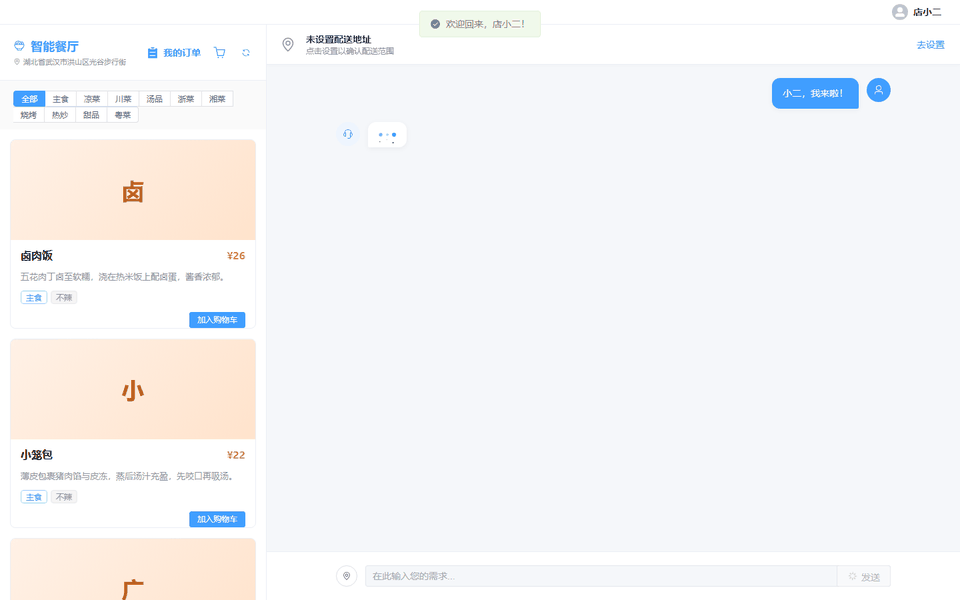
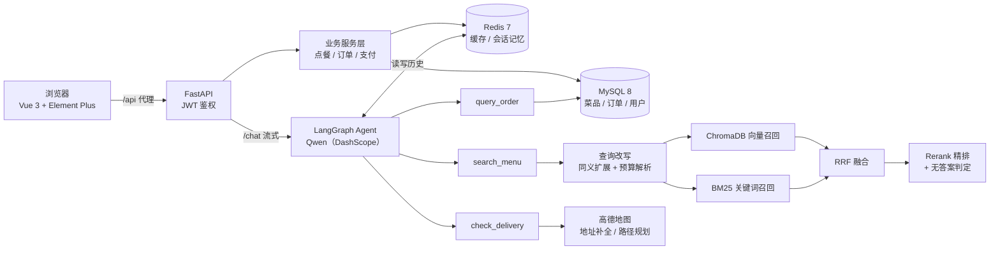

# AiMenu 智能点餐系统 (AiMenu Smart Ordering System)

[](https://www.python.org/)
[](https://vuejs.org/)
[](https://www.docker.com/)
[](LICENSE)

AiMenu 是一个可本地运行的全栈 AI 点餐项目：FastAPI 提供业务接口，LangGraph 编排工具调用型 Agent，
ChromaDB + BM25 + Rerank 完成菜品检索，高德地图负责配送范围校验，Vue 3 + Element Plus 提供点餐界面。



> 真实录屏（未加速）：一次「有什么清淡不辣的汤推荐」的流式对话，被推荐菜品在左侧标注「推荐」徽标，可直接加购。

---

## 核心能力

- **工具调用型 Agent**：LangGraph 构建「决策 → 调用工具 → 生成回复」循环，接入菜单检索、配送校验、订单查询三类工具，支持 SSE 流式输出；多轮历史、配送地址与用餐约束（辣度/预算/素食）槽位落 Redis（按 `user_id + session_id` 隔离、滑动 TTL）。
- **混合检索**：向量召回（text-embedding-v3/v4，可用 `EMBEDDING_MODEL` 切换）+ BM25 关键词召回，RRF 融合后由 Rerank 精排（云端 `qwen3-vl-rerank` 或本地 `bge-reranker-v2-m3`）；口语 query 做同义扩展，预算/辣度/素食约束在检索前按 metadata 硬过滤。
- **无答案拒答**：以 Rerank 最高分作为相关度信号，低于阈值返回 `answerable=false`，Agent 如实告知没有该菜品而非硬推；阈值按 dev/test 切分标定。
- **配送与订单闭环**：高德地址补全、地理编码、路径规划与阶梯配送费；JWT 登录、购物车、下单、模拟支付、订单历史。
- **订单一致性**：服务端重算金额，单事务完成库存扣减，`Idempotency-Key` 幂等 + 唯一索引防重复下单，订单状态机拒绝非法跃迁。
- **缓存与并发**：Redis 缓存菜单与地理结果（延迟双删），MySQL 连接池 + 阻塞调用移出事件循环，本地压测 QPS 57.8 → 332.2（并发 20）。

---

## 系统架构



---

## 技术栈

| 层次 | 技术 |
| --- | --- |
| 后端 | FastAPI、Uvicorn、Pydantic |
| AI | LangGraph、LangChain、Qwen（DashScope）、text-embedding-v3/v4（可切换）、qwen3-vl-rerank / bge-reranker-v2-m3（本地可选） |
| 检索 | ChromaDB、rank_bm25、jieba |
| 存储 | MySQL 8、Redis 7 |
| 前端 | Vue 3、Element Plus、Pinia、Vite |
| 部署 | Docker / Docker Compose、GitHub Actions |

---

## 目录结构

```text
AiMenu/
├── agent/              # Agent 状态机、工具定义、Redis 会话记忆
├── api/                # FastAPI 路由与请求/响应模型
├── service/            # 业务服务层（点餐、订单、支付）
├── tools/              # MySQL / Redis / ChromaDB / 高德 / JWT / 查询改写工具
├── tests/              # 单元测试与接口测试（114 passed / 1 skipped）
├── scripts/            # 检索评测、阈值标定、Agent 评测与压测脚本
├── data/               # 菜品（1060 道）、标注（585 条）、域外问题集（84 条）
├── docs/               # 评测细节与开发文档（evaluation.md）
├── ui/                 # Vue 3 前端工程（Pinia stores + Playwright e2e）
├── .github/workflows/  # CI：后端 ruff + pytest，前端构建（+ 可选检索评测）
├── docker-compose.yml  # 默认 MySQL(3307) + Redis(6379)
├── Dockerfile          # 后端多阶段构建镜像
├── setup_db.py         # 建表 + 菜品初始化 + 向量同步
└── requirements.txt
```

---

## 快速开始

### 1. 配置环境变量

```bash
# Windows
copy .env.example .env
# macOS / Linux
cp .env.example .env
```

至少需要填写 `DASHSCOPE_API_KEY`（大模型与向量化）和 `AMAP_API_KEY`（配送校验）。

### 2. 启动中间件

```bash
docker compose up -d
```

默认启动 MySQL（宿主机 3307）与 Redis（宿主机 6379）。

### 3. 初始化并启动后端

```bash
# 推荐使用 uv
uv venv --python 3.10
.venv\Scripts\activate        # macOS/Linux: source .venv/bin/activate
uv pip install -r requirements.txt

python setup_db.py            # 建表 + 1060 道菜品 + 向量入库（可重复执行）
python run.py
```

API 地址：http://127.0.0.1:8001 ，接口文档：http://127.0.0.1:8001/docs

### 4. 启动前端

```bash
cd ui
npm install
npm run dev
```

访问 http://localhost:3000 （Vite 已配置 `/api` 代理到后端）。

### 5. Docker Compose 一键启动（可选）

```bash
docker compose --profile full up -d --build
docker compose --profile full run --rm backend python setup_db.py
docker compose --profile full restart backend   # 重新加载 BM25 语料
```

前端 http://localhost:8080 ，后端 http://localhost:8001 。镜像多阶段构建、非 root 运行，
默认 gunicorn + 2 个 uvicorn worker（`WEB_CONCURRENCY` 可调）。

---

## 测试与评测

```bash
# 代码规范检查（ruff，CI 同一套规则）
ruff check .

# 单元测试与接口测试（不依赖数据库、外部 API）
pytest -q

# 检索评测（需要 DashScope 可用 + 已执行 setup_db.py）
python scripts/eval_rag.py --top-k 3 --json eval_result.json

# 拒答阈值 dev/test 标定
python scripts/eval_threshold.py --json data/eval_threshold_v3.json

# Agent 端到端评测：工具选择、answerable 判定与拒答话术
python scripts/eval_agent.py --no-judge --model qwen3.5-plus-2026-02-15 --json data/eval_agent_full_qwen35.json

# 接口压测（需后端已启动）
python scripts/loadtest.py --concurrency 20 --duration 10 --paths /healthy,/menu/list \
    --json data/loadtest_rest.json

# 流式对话压测：并发梯度 + 首字延迟 + tokens/s + 429 统计
python scripts/loadtest.py --stream --sweep 5,10,20 --requests-per-worker 1 \
    --cooldown 65 --json data/loadtest_stream.json
```

1060 道菜品、585 条四类分层标注上的检索结果（本地 `bge-reranker-v2-m3` + `text-embedding-v3`）：

| 检索策略 | Top-1 | Top-3 | MRR |
| --- | --- | --- | --- |
| 纯向量检索 | 0.7214 | 0.8359 | 0.7729 |
| 向量 + BM25 融合（RRF） | 0.7385 | 0.8735 | 0.8000 |
| 向量 + BM25 + Rerank | **0.8120** | **0.9043** | **0.8524** |

> 完整的分类型指标、拒答阈值标定、Agent 端到端评测、模型 A/B、流式压测与冷启动数据见
> [docs/evaluation.md](./docs/evaluation.md)。所有指标均基于本地模拟语料，不代表线上规模。

前端 e2e（Playwright，需后端已在 8001 启动）：

```bash
cd ui
npx playwright install chromium      # 本机下载受限时可用 PW_CHANNEL=msedge 复用系统 Edge
npx playwright test
```

### 本地 Rerank（免额度）

```bash
pip install -r requirements-local-rerank.txt
# .env 中设置：
# RERANK_PROVIDER=local
# LOCAL_RERANK_MODEL=BAAI/bge-reranker-v2-m3
# EMBEDDING_MODEL=text-embedding-v3
# EMBEDDING_DIM=1024
# RETRIEVAL_MIN_SCORE=0.245
```

换 embedding 模型后需执行 `python setup_db.py` 重建索引，并用 `scripts/eval_threshold.py` 重新标定阈值；
云端 Rerank 额度用尽时会自动降级为融合排序，不阻断对话。

---

## 关键设计

### 订单一致性

- 下单在单事务内完成「幂等校验 → 按菜品 ID 升序 `SELECT ... FOR UPDATE` 锁库存 → 校验并扣减 → 写订单」，任一步失败显式回滚。
- `Idempotency-Key` + 唯一索引：重试或并发重复提交只落一单、库存只扣一次；前端每次下单生成一次性 UUID 并拦截重复点击。
- 订单状态机 `pending → paid → completed`，`pending` 可取消、终态冻结，非法跃迁返回 409。
- 并发验证：`scripts/verify_oversell.py`（库存 5、20 线程各下 1 份 → 成功 5、拒绝 15、最终库存 0）。

### 安全

- 密码 bcrypt 加盐哈希，JWT Bearer Token；支付校验订单归属，越权返回 403。
- 金额与配送费由服务端重算；SQL 全部参数化；订单查询工具执行前强制注入当前 `user_id`。
- 图入口确定性护栏：空输入/纯标点、索要他人订单或隐私的请求直接拒答，不进入模型也不调工具。
- 对话与登录按 Redis 分钟级限流；JWT 不使用仓库默认密钥；安全响应头 + 1MB 请求体上限 + 参数长度收敛。
- 前端先转义再渲染 Markdown，避免 DOM XSS。

### 可观测性

- HTTP 中间件生成或透传 `X-Trace-ID`，日志统一带 trace_id，`LOG_FORMAT=json` 可切结构化输出。
- `GET /metrics/cost` 暴露当前 worker 的模型调用次数、token 用量与按单价估算的成本；SSE 末尾同步下发 `usage` 事件。

### 性能与冷启动

- MySQL 连接池 + 阻塞调用移出事件循环：本地并发 20 压测整体 QPS 57.8 → 332.2，复跑 355.3 / 363.2，零错误。
- Rerank 权重与 Agent 模块改为启动后后台线程预热：首个对话 TTFT 19.3s → 1.95s，总耗时 28.6s → 6.53s。

---

## 已知限制

- 检索指标基于 1060 道菜品的**模拟语料**（大模型按菜系生成），用于压测检索链路与回归对比，不代表真实餐厅菜单分布。
- 属性约束类检索 Top-1 0.4947 / Top-3 0.6842（硬过滤后 Rerank 只在有效集合里排，Top-3 较 v4 提升 +1.05pt）；「预算 + 属性」型 query 的 Rerank 分数仍偏低，存在误拒。
- Agent 多轮场景下，对**没有新查询对象、只改约束**的追问（如「都不要辣的」），LLM 有漏调 `search_menu` 的倾向——误以为上一轮已检索过、不需要再搜。**已通过 P1 强制注入修复**（`agent/langgraph_agent.py` 的 `call_model()` 末尾 post-check）：LLM 没调工具 + 命中纯约束变更正则 → 强制注入 `search_menu`，同时手动更新约束槽位；三层死循环防护（最近 search_menu 检查、迭代上限 12、系统 prompt 第 9 条）防注入循环和 LLM 主动重复调工具。
- Agent 端到端评测为 65 条固定用例（含 4 条 P0 新增的多轮约束/菜名有效性用例），最终答复与拒答由 LLM 评审判定，重跑有波动，不能替代真实流量。
- 本地 Rerank 为 CPU 推理，单次混合检索 P50 约 2.60s；云端 Rerank 额度紧张，需关注降级行为。
- 支付为模拟实现；通知推送为 `BackgroundTasks` 占位；JWT 无 refresh token 与主动吊销。
- 菜品图片仅覆盖 12/1060，其余用菜名首字占位。

---

## 界面预览


> 登录后的主界面：左侧按菜系/分类筛选菜品，右侧为对话点餐窗口，顶部横幅用于设置配送地址。

---

## 测试账号

- 用户名：`admin`
- 密码：`password123`

首次部署后请立即修改默认密码与 `JWT_SECRET_KEY`。

---

## License

本项目基于 [MIT License](LICENSE) 开源。
