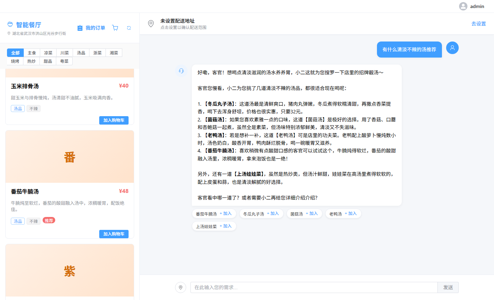
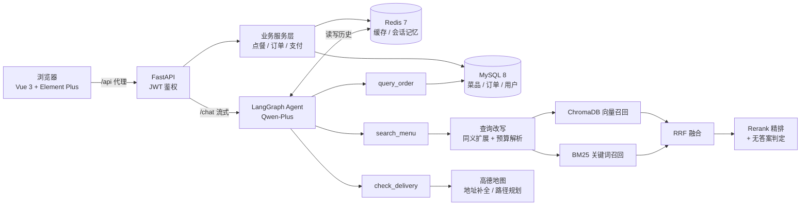
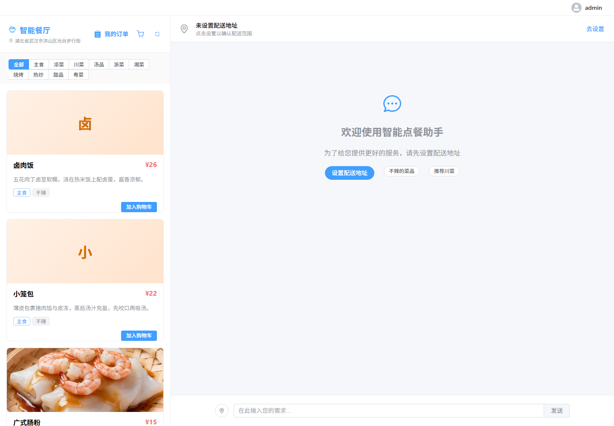

# AiMenu 智能点餐系统 (AiMenu Smart Ordering System)

[](https://www.python.org/)
[](https://vuejs.org/)
[](https://www.docker.com/)
[](LICENSE)

AiMenu 是一个可本地运行的全栈 AI 点餐项目：FastAPI 提供业务接口，LangGraph 编排工具调用型 Agent，
ChromaDB + BM25 + Rerank 完成菜品检索，高德地图负责配送范围校验，Vue 3 + Element Plus 提供点餐界面。



> 真实运行截图：一次「有什么清淡不辣的汤推荐」的流式对话，Agent 调用检索工具后给出推荐，
> 左侧菜单同步高亮「推荐」菜品，回复下方可直接加购。

> 指标说明：以下检索指标由 `scripts/eval_rag.py` 在 153 道菜品的本地语料、150 条标注上实测，
> 可通过同一脚本复现；语料为模拟数据，绝对值不代表线上大规模场景效果。

---

## 核心能力

- **工具调用型 Agent**：基于 LangGraph 构建「决策 → 调用工具 → 生成回复」循环，接入菜单检索、配送校验、订单查询三类工具，支持 SSE 流式输出与多轮上下文。
- **会话记忆持久化**：多轮历史写入 Redis（按 `session_id` 分键、滑动 TTL），服务重启或换实例后仍能续上上下文，不再依赖进程内 `MemorySaver`。
- **混合检索**：向量召回（text-embedding-v4）+ BM25 关键词召回，RRF 合并去重后由 DashScope Rerank 精排；Rerank 不可用时自动降级为融合结果。
- **口语化查询改写**：无菜名、偏口语的 query（"广式烧腊里的甜口猪肉"）先做同义扩展兜底召回；"四十块以内"这类预算约束会解析成价格区间并过滤候选。
- **无答案拒答**：以 Rerank 最高分为相关度信号，低于阈值时返回 `answerable=false`，Agent 如实告知"没有这道菜"而不是硬推不相关菜品；阈值在标注集与域外问题上实测选定。
- **配送范围校验**：高德地址补全、地理编码与路径规划，按距离计算阶梯配送费并拦截超范围下单。
- **订单闭环**：JWT 登录、菜单、购物车、下单、模拟支付、订单历史；金额与配送费由服务端重算。
- **缓存与一致性**：Redis 缓存地理编码、距离计算结果与菜单热点数据；菜品更新采用延迟双删策略。
- **并发性能**：MySQL 连接池 + 阻塞调用移出事件循环，压测整体 QPS 从 57.8 提升到 332.2（并发 20，详见「性能与并发」）。

---

## 系统架构



---

## 技术栈

| 层次 | 技术 |
| --- | --- |
| 后端 | FastAPI、Uvicorn、Pydantic |
| AI | LangGraph、LangChain、Qwen-Plus（DashScope）、text-embedding-v4、gte-rerank |
| 检索 | ChromaDB、rank_bm25、jieba |
| 存储 | MySQL 8、Redis 7 |
| 前端 | Vue 3、Element Plus、Pinia、Vite |
| 部署 | Docker / Docker Compose |

---

## 目录结构

```text
AiMenu/
├── agent/              # Agent 状态机、工具定义、Redis 会话记忆
├── api/                # FastAPI 路由与请求/响应模型
├── service/            # 业务服务层（点餐、订单、支付）
├── tools/              # MySQL / Redis / ChromaDB / 高德 / JWT / 查询改写工具
├── tests/              # 单元测试与接口测试
├── scripts/            # 检索评测（eval_rag.py）与压测（loadtest.py）
├── data/               # 菜品（153 道）、检索标注（150 条）、域外问题集（18 条）
├── screenshots/        # README 展示用真实运行截图
├── ui/                 # Vue 3 前端工程（components + Pinia stores）
├── .github/workflows/  # CI：后端 pytest + 前端构建
├── docker-compose.yml  # 默认 MySQL(3307) + Redis(6379)，full 模式含前后端
├── Dockerfile          # 后端镜像
├── setup_db.py         # 建表 + 菜品数据初始化 + 向量同步
├── run.py              # 后端启动入口
└── requirements.txt
```

---

## 快速开始

### 1. 配置环境变量

```bash
# Windows
copy .env.example .env
# macOS / Linux
cp .env.example .env
```

至少需要填写 `DASHSCOPE_API_KEY`（大模型与向量化）和 `AMAP_API_KEY`（配送校验）。

### 2. 启动中间件

```bash
docker compose up -d
```

默认启动 MySQL（宿主机 3307）与 Redis（宿主机 6379）。

### 3. 初始化并启动后端

```bash
# 推荐使用 uv
uv venv --python 3.10
.venv\Scripts\activate        # macOS/Linux: source .venv/bin/activate
uv pip install -r requirements.txt

python setup_db.py            # 建表 + 153 道菜品 + 向量入库（可重复执行）
python run.py
```

API 地址：http://127.0.0.1:8001 ，接口文档：http://127.0.0.1:8001/docs

### 4. 启动前端

```bash
cd ui
npm install
npm run dev
```

访问 http://localhost:3000 （Vite 已配置 `/api` 代理到后端）。

### 可选：构建镜像

```bash
docker build -t aimenu-backend .
docker build -t aimenu-web ./ui
```

`ui/nginx.conf` 已包含 `/api` 反向代理与 SSE 关闭缓冲的配置。

也可以直接用 Compose 拉起完整环境（db + redis + backend + web）：

```bash
copy .env.example .env      # 填写 DASHSCOPE_API_KEY / AMAP_API_KEY
docker compose --profile full up -d --build
# 首次启动后初始化菜品与向量数据
docker compose --profile full run --rm backend python setup_db.py
```

前端访问 http://localhost:8080 ，后端 http://localhost:8001 。不带 `--profile full` 时
`docker compose up -d` 仍只启动 MySQL 与 Redis，方便在本机直接跑后端开发服务。

---

## 测试与评测

```bash
# 单元测试与接口测试（不依赖数据库、外部 API）
pytest -q

# 真实链路检索评测（需要 DashScope 可用 + 已执行 setup_db.py）
python scripts/eval_rag.py --top-k 3 --json eval_result.json

# 只评测可离线复现的融合链路（跳过 Rerank 与拒答）
USE_RERANK=false python scripts/eval_rag.py --top-k 3 --no-refusal

# 接口压测（需后端已启动）
python scripts/loadtest.py --concurrency 20 --duration 10 --paths /healthy,/menu/list

# 将检索评测接入 pytest（可选）
RUN_INTEGRATION=1 pytest tests/test_retrieval.py -s
```

`data/eval_labels.json` 内置 150 条「query → 期望菜品」标注，覆盖 153 道菜品的全部条目，
分别统计纯向量检索、向量 + BM25 融合（RRF）、混合检索（+Rerank）的 Recall@K 和 MRR；
`data/eval_negative.json` 内置 18 条域外问题，用于统计「无答案拒答率」；
若 Embedding 接口不可用，脚本会直接中止而不是输出失真指标。

### 实测结果（Top-3，153 道菜品，150 条标注）

| 检索策略 | Recall@3 | MRR |
| --- | --- | --- |
| 纯向量检索 | 0.9733 | 0.9456 |
| 向量 + BM25 融合（RRF） | 0.9600 | 0.9333 |
| 向量 + BM25 + Rerank | **0.9800** | **0.9600** |

数据来源：`data/menu_items.json`（菜品）、`data/eval_labels.json`（标注，含 40 条菜名直查、
40 条口语化改写、50 条属性组合、20 条菜系/分类查询）。Embedding 接口存在少量随机性，
重跑指标会有 ±0.01 波动；混合检索改造前的 3 条失败样本均为不含菜名的强口语改写。

### 查询改写后的逐条复测

| 样本 | 改造前 | 改造后 |
| --- | --- | --- |
| 那种红亮亮的甜口红烧肉 | Top-3 未命中 | 东坡肉 命中 Top-1 |
| 广式烧腊里的甜口猪肉 | Top-3 未命中 | 蜜汁叉烧 命中 Top-1 |
| 四十块以内的下饭菜 | Top-3 未命中 | 鱼香茄子 命中 Top-1（预算过滤生效） |
| 融合链路全量（`USE_RERANK=false`） | 0.9600 / 0.9333 | 0.9600 / 0.9344 |

说明：复测期间 DashScope Rerank 免费额度耗尽（接口返回 free quota exhausted），
因此没有再给出改进后的全量混合检索整体数字，只记录可复现的融合链路指标与逐条结果；
额度恢复后重跑 `python scripts/eval_rag.py` 即可得到新的整体指标。检索代码在 Rerank
不可用时会自动降级为融合排序，并把拒答判定置为「无法判断」，不会误拒正常 query。

### 无答案拒答（阈值实测）

在 150 条标注问题与 18 条域外问题（天气、写代码、帝王蟹、无糖可乐…）上统计 Rerank 最高分：

| 分布 | 标注问题 top1 分数 | 域外问题 top1 分数 |
| --- | --- | --- |
| 最低 | 0.1334 | 0.0060 |
| 中位数 | 0.2762 | 0.0061 |
| 最高 | — | 0.1530 |

取 `RETRIEVAL_MIN_SCORE=0.13`：**标注问题 150/150 判为可回答（无误拒），域外问题 17/18 被拒答**；
唯一漏网是「有没有无糖可乐」被「可乐鸡翅」以 0.153 分召回，属于同词根误判。

### 相关环境变量

| 变量 | 默认值 | 说明 |
| --- | --- | --- |
| USE_RERANK | true | 关闭后只做向量 + BM25 融合 |
| RETRIEVAL_REWRITE_SCORE | 0.20 | 首轮 Rerank 最高分低于该值时启用同义扩展兜底召回 |
| RETRIEVAL_MIN_SCORE | 0.13 | 低于该值判定「菜单无法回答」（返回 `answerable=false`） |
| BM25_EXPANSION_WEIGHT | 0.5 | 扩展词的 BM25 分数权重 |
| MYSQL_POOL_SIZE | 10 | MySQL 连接池大小 |
| AGENT_MEMORY_TTL / AGENT_MEMORY_TURNS | 86400 / 6 | 会话记忆过期时间（秒）与保留轮数 |

---

## 性能与并发

改造点：

1. MySQL 改为连接池（`MYSQL_POOL_SIZE` 默认 10），避免每个请求都新建 TCP 连接与鉴权；
2. 鉴权依赖与业务路由里的同步 DB / 高德 HTTP 调用不再直接写在 `async` 函数中执行，
   改为 `run_in_threadpool` 或同步处理函数（由 FastAPI 线程池执行），事件循环不再被占住；
3. 新增 `scripts/loadtest.py`（httpx 并发压测，登录后压 `/healthy` 与 `/menu/list`）。

同一台机器、并发 20、持续 10 秒，每个请求都带 Token（`/menu/list` 包含鉴权依赖中的数据库查询）：

| 指标 | 改造前 | 改造后 |
| --- | --- | --- |
| 整体 QPS | 57.8 | **332.2** |
| /healthy P95 | 623.8 ms | 203.8 ms |
| /menu/list P95 | 277.2 ms | 165.0 ms |

复跑一次为 315.2 QPS（`/menu/list` P95 168.9 ms），量级一致。改造前连 `/healthy` 这种纯内存接口
都要 500ms 以上，原因就是 `/menu/list` 里的同步数据库调用占住了事件循环。

```bash
# 复现（需后端已启动在 8001）
python scripts/loadtest.py --concurrency 20 --duration 10 --paths /healthy,/menu/list
```

---

## 安全设计

- 密码使用 bcrypt 加盐哈希，认证使用 JWT Bearer Token。
- 支付接口校验订单归属，越权操作返回 403。
- 下单金额、配送费由服务端依据数据库价格与实时距离重算，不信任客户端传值。
- SQL 全部参数化；Agent 的订单查询工具强制按当前 `user_id` 过滤。

---

## 已知限制

- 检索指标基于 153 道菜品、150 条标注的模拟数据，用于链路验证与回归对比；不含菜名的口语化改写仍是主要失误来源。
- DashScope Rerank 使用免费额度，额度耗尽后自动降级为融合排序，此时的拒答判定为「无法判断」而不是误判。
- 菜品图片只覆盖部分菜品，无图菜品用菜名首字占位；原图体积偏大（数 MB 级 PNG），尚未做压缩与 CDN。
- 支付为模拟实现，未接入真实支付渠道；通知推送为 `BackgroundTasks` 占位逻辑。

---

## 界面预览



> 登录后的主界面：左侧按菜系/属性筛选菜品，右侧是对话点餐窗口与配送地址设置。

---

## 测试账号

- 用户名：`admin`
- 密码：`password123`

首次部署后请立即修改默认密码与 `JWT_SECRET_KEY`。

---

## License

本项目基于 [MIT License](LICENSE) 开源。
