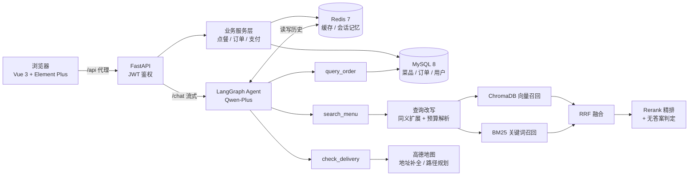

# AiMenu 智能点餐系统 (AiMenu Smart Ordering System)

[](https://www.python.org/)
[](https://vuejs.org/)
[](https://www.docker.com/)
[](LICENSE)

AiMenu 是一个可本地运行的全栈 AI 点餐项目：FastAPI 提供业务接口，LangGraph 编排工具调用型 Agent，
ChromaDB + BM25 + Rerank 完成菜品检索，高德地图负责配送范围校验，Vue 3 + Element Plus 提供点餐界面。


> 真实录屏（未加速）：一次「有什么清淡不辣的汤推荐」的流式对话，被推荐菜品在左侧标注「推荐」徽标，可直接加购；
> 同一场景的静态截图见 `screenshots/chat.png`。
> 下方检索指标由 `scripts/eval_rag.py` 在 1060 道菜的本地模拟语料、585 条分层标注上实测，可复现，不代表线上规模效果。

---

## 核心能力

- **工具调用型 Agent**：基于 LangGraph 构建「决策 → 调用工具 → 生成回复」循环，接入菜单检索、配送校验、订单查询三类工具，支持 SSE 流式输出与多轮上下文。
- **会话记忆持久化**：多轮历史写入 Redis（按 `session_id` 分键、滑动 TTL），服务重启或换实例后仍能续上上下文，不再依赖进程内 `MemorySaver`。
- **混合检索**：向量召回（text-embedding-v4）+ BM25 关键词召回，RRF 合并去重后精排——默认 DashScope qwen3-vl-rerank，也可切到本地 `bge-reranker-v2-m3`（免额度、可离线复现）；Rerank 不可用时自动降级为融合结果。
- **口语化查询改写**：无菜名、偏口语的 query（"广式烧腊里的甜口猪肉"）先做同义扩展兜底召回；"四十块以内"这类预算约束会解析成价格区间并过滤候选。
- **无答案拒答**：以 Rerank 最高分为相关度信号，低于阈值时返回 `answerable=false`，Agent 如实告知"没有这道菜"而不是硬推不相关菜品；阈值在标注集与域外问题上实测选定。
- **配送范围校验**：高德地址补全、地理编码与路径规划，按距离计算阶梯配送费并拦截超范围下单。
- **订单闭环**：JWT 登录、菜单、购物车、下单、模拟支付、订单历史；金额与配送费由服务端重算；下单在单个事务内完成库存扣减，支持 `Idempotency-Key` 幂等与订单状态机。
- **缓存与一致性**：Redis 缓存地理编码、距离计算结果与菜单热点数据；菜品更新采用延迟双删策略。
- **并发性能**：MySQL 连接池 + 阻塞调用移出事件循环，压测整体 QPS 从 57.8 提升到 332.2（并发 20，详见「性能与并发」）。

---

## 系统架构



---

## 技术栈

| 层次 | 技术 |
| --- | --- |
| 后端 | FastAPI、Uvicorn、Pydantic |
| AI | LangGraph、LangChain、Qwen-Plus（DashScope）、text-embedding-v4、qwen3-vl-rerank / bge-reranker-v2-m3（本地可选） |
| 检索 | ChromaDB、rank_bm25、jieba |
| 存储 | MySQL 8、Redis 7 |
| 前端 | Vue 3、Element Plus、Pinia、Vite |
| 部署 | Docker / Docker Compose |

---

## 目录结构

```text
AiMenu/
├── agent/              # Agent 状态机、工具定义、Redis 会话记忆
├── api/                # FastAPI 路由与请求/响应模型
├── service/            # 业务服务层（点餐、订单、支付）
├── tools/              # MySQL / Redis / ChromaDB / 高德 / JWT / 查询改写工具
├── tests/              # 单元测试与接口测试
├── scripts/            # 检索评测（eval_rag.py）与压测（loadtest.py）
├── data/               # 菜品（1060 道）、检索标注（585 条）、域外问题集（84 条）
├── screenshots/        # README 展示用真实运行截图
├── ui/                 # Vue 3 前端工程（components + Pinia stores + Playwright e2e）
├── .github/workflows/  # CI：后端 pytest + 前端构建（+ 可选检索评测）
├── docker-compose.yml  # 默认 MySQL(3307) + Redis(6379)，full 模式含前后端
├── Dockerfile          # 后端镜像
├── setup_db.py         # 建表 + 菜品数据初始化 + 向量同步
├── run.py              # 后端启动入口
└── requirements.txt
```

---

## 快速开始

### 1. 配置环境变量

```bash
# Windows
copy .env.example .env
# macOS / Linux
cp .env.example .env
```

至少需要填写 `DASHSCOPE_API_KEY`（大模型与向量化）和 `AMAP_API_KEY`（配送校验）。

### 2. 启动中间件

```bash
docker compose up -d
```

默认启动 MySQL（宿主机 3307）与 Redis（宿主机 6379）。

### 3. 初始化并启动后端

```bash
# 推荐使用 uv
uv venv --python 3.10
.venv\Scripts\activate        # macOS/Linux: source .venv/bin/activate
uv pip install -r requirements.txt

python setup_db.py            # 建表 + 1060 道菜品 + 向量入库（可重复执行）
python run.py
```

API 地址：http://127.0.0.1:8001 ，接口文档：http://127.0.0.1:8001/docs

### 4. 启动前端

```bash
cd ui
npm install
npm run dev
```

访问 http://localhost:3000 （Vite 已配置 `/api` 代理到后端）。

### 可选：构建镜像

```bash
docker build -t aimenu-backend .
docker build -t aimenu-web ./ui
```

`ui/nginx.conf` 已包含 `/api` 反向代理与 SSE 关闭缓冲的配置。

也可以直接用 Compose 拉起完整环境（db + redis + backend + web）：

```bash
copy .env.example .env      # 填写 DASHSCOPE_API_KEY / AMAP_API_KEY
docker compose --profile full up -d --build
# 首次启动后初始化菜品与向量数据；随后重启后端，让 worker 重新加载 BM25 语料
docker compose --profile full run --rm backend python setup_db.py
docker compose --profile full restart backend
```

前端访问 http://localhost:8080 ，后端 http://localhost:8001 。不带 `--profile full` 时
`docker compose up -d` 仍只启动 MySQL 与 Redis，方便在本机直接跑后端开发服务。

后端镜像为多阶段构建、非 root 用户运行，默认用 gunicorn 起 2 个 uvicorn worker；
可通过 `WEB_CONCURRENCY` 调整。向量库挂载在 `chroma_data` 卷上，容器重建后无需重新入库
（重新执行 `setup_db.py` 即可覆盖更新）。

---

## 测试与评测

```bash
# 单元测试与接口测试（不依赖数据库、外部 API）
pytest -q

# 真实链路检索评测（需要 DashScope 可用 + 已执行 setup_db.py）
python scripts/eval_rag.py --top-k 3 --json eval_result.json

# 只评测可离线复现的融合链路（跳过 Rerank 与拒答）
# PowerShell 写法：$env:USE_RERANK="false"; python scripts/eval_rag.py --top-k 3 --no-refusal
USE_RERANK=false python scripts/eval_rag.py --top-k 3 --no-refusal

# 接口压测（需后端已启动）
python scripts/loadtest.py --concurrency 20 --duration 10 --paths /healthy,/menu/list

# 压流式对话 /chat/stream：并发梯度 + 首字延迟 + tokens/s + 429 统计
python scripts/loadtest.py --stream --sweep 5,10,20 --requests-per-worker 1 \
    --cooldown 65 --json data/loadtest_stream.json

# 拒答阈值 held-out 标定：只在 dev 上选阈值，再到 test 上报误拒率
python scripts/eval_threshold.py --json data/eval_threshold.json

# Agent 端到端评测：工具选择、answerable 判定与拒答话术
python scripts/eval_agent.py --json data/eval_agent.json

# 模型 A/B：指定代理模型，评审模型建议固定（这里两组都用自己的模型，评审指标只作参考）
python scripts/eval_agent.py --model qwen-plus --judge-model qwen-plus --json data/eval_agent_model_b.json

# 与基线对比：任一核心指标低于基线超过 0.02 时以退出码 3 失败
python scripts/eval_rag.py --top-k 3 --quiet --no-ablation --baseline data/eval_baseline.json

# 将检索评测接入 pytest（可选）
RUN_INTEGRATION=1 pytest tests/test_retrieval.py -s
```

`data/eval_baseline.json` 记录了当前语料（1060 道）与本地 `bge-reranker-v2-m3` 下的指标基线，用于防止检索效果悄悄回退。
评测的确定性：`eval_rag.py` 默认把每段被向量化的文本（含查询改写后的变体）按 sha1 缓存到
`data/eval_embedding_cache.npz`，重跑直接命中缓存——指标不会因为 Embedding 服务的浮点漂移而抖动，
CI 里也不再依赖实时额度。语料或标注改动后用 `--refresh-embedding-cache` 重建，`--no-embedding-cache`
可关闭缓存走真实接口。基线对比的 `--max-drop` 仍是 0.02，它防的是「静默回退」，不是精度阈值。


CI 中的 `retrieval-eval` job 默认不运行（真实评测会消耗 Embedding / Rerank 额度）：
配置仓库变量 `RUN_RETRIEVAL_EVAL=true` 与 secret `DASHSCOPE_API_KEY` 后自动启用，
也可以在 Actions 页面手动触发（`workflow_dispatch`）。

`data/eval_labels.json` 内置 585 条「query → 期望菜品」分层标注，按 `type` 分四类：
`name_exact` 125 条（菜名直查）、`colloquial` 270 条（口语化描述）、`attribute` 95 条（辣度/素食/预算/做法等属性约束）、
`near_miss` 95 条（与语料里易混菜名做区分）。脚本分别统计纯向量检索、向量 + BM25 融合（RRF）、
混合检索（+Rerank）的 Top-1 / Top-3 / Recall@K / MRR，并输出分类型指标、随机基线（从语料里随机取 3 道菜的期望命中率）
与单次检索耗时 P50/P95。
`data/eval_negative.json` 内置 84 条域外问题，按 `type` 分六类（非餐饮领域 20、业务能力外 14、菜单中不存在 17、
prompt 注入 15、越权请求 10、无意义输入 8），用于统计「无答案拒答率」及分类型拒答率；
若 Embedding 接口不可用，脚本会直接中止而不是输出失真指标。

### 前端端到端测试（Playwright）

```bash
cd ui
npm install
npx playwright install chromium      # 本机下载受限时可用 PW_CHANNEL=msedge 复用系统 Edge
npx playwright test                  # 需后端已在 8001 启动
```

三条用例全部打真实后端，覆盖用户主路径：

| 用例 | 覆盖点 |
| --- | --- |
| 未登录访问 | 登录墙（弹窗不可关闭、主区域模糊）→ 登录成功 → 菜单加载 |
| 流式对话 | 发一条会触发推荐的 query，断言回复长度多次增长（边收边渲染）、推荐卡片出现、点「+ 加入」后购物车角标变化 |
| 下单幂等 | 真实高德配送校验 → 加购 → 同帧连点两次「提交订单」：只发出 1 次 `POST /order/submit`、请求头带 `Idempotency-Key`、订单数 +1 |

本机（Windows + 系统 Edge、后端单 worker）整套 3 条用例实测 3 passed / 46.1s；首次跑到流式用例时
本地 Rerank 模型需要加载，单条会到 2.6 分钟。配送地址用餐厅附近的「武汉市洪山区光谷步行街」
（6.33km、配送费 9.7 元）；填其他城市会因超出 10km 配送范围被服务端拒绝。
`ui/test-results/`、`ui/playwright-report/` 是失败时的截图与 trace，已在 `.gitignore` 中忽略。

### 本地 Rerank（免额度，可复现）

云端 Rerank 免费额度用尽后，检索会降级为融合排序、拒答判定失效。项目支持切到本地
Cross-Encoder（默认 `BAAI/bge-reranker-v2-m3`）：

```bash
pip install -r requirements-local-rerank.txt
# 国内网络建议使用 ModelScope 下载模型（约 2.3GB）
pip install modelscope -i https://pypi.tuna.tsinghua.edu.cn/simple
python -c "from modelscope import snapshot_download; print(snapshot_download('BAAI/bge-reranker-v2-m3'))"
```

把输出目录填入 `.env` 的 `LOCAL_RERANK_MODEL`；也可以直接写 HuggingFace 仓库名，此时会走
`HF_ENDPOINT`（可设为 `https://hf-mirror.com`）下载。

在 `.env` 中设置：

```dotenv
RERANK_PROVIDER=local
LOCAL_RERANK_MODEL=BAAI/bge-reranker-v2-m3
LOCAL_RERANK_DEVICE=auto
```

直接写 HuggingFace 仓库名时，首次运行会下载约 2.3GB 到 `~/.cache/huggingface`；用 ModelScope
下到本地目录再填绝对路径则不会联网。有 GPU 时设置
`LOCAL_RERANK_DEVICE=cuda`、`LOCAL_RERANK_FP16=true`；纯 CPU 也能跑，只是单次重排更慢。
模型加载或推理失败会自动降级为融合排序，不会阻断对话。切换模型后分数分布会变化，
必须用 `scripts/eval_threshold.py` 重新标定阈值。

> `.env.example` 里显式写了云端的 `RETRIEVAL_MIN_SCORE=0.64`；切到本地模型后要把它改成
> `0.115`（或删掉该行，让代码按 `RERANK_PROVIDER` 取默认值），否则会沿用云端阈值。

#### 重排输入归一化（本地模型踩坑）

直接把用户的原始口语和「`菜品ID:1|菜品名称:x|价格:¥9.9|…`」元数据串喂给 bge-reranker
会得到失真分数。以酸辣土豆丝为例：query 是「想吃土豆」只有 0.01，「土豆」0.24（原始元数据串）
/ 0.42（结构化文本），「土豆丝」0.97；「想喝汤」0.03，「汤」0.62。结果是当时那批 150 条标注里有
59 条（39%）的最高分低于 0.33，和域外问题的分数区间重叠，阈值怎么调都会大量误拒。
（这组数字在旧 153 道语料上测得，语料扩到 1060 道后分数区间已经变化，这里只用来说明归一化的动机。）

因此本地 Rerank 前做两步确定性归一化（`build_rerank_query` / `format_rerank_document`）：

1. **query 还原成名词短语**：剥掉「想吃 / 来一份 / 有什么」等意图词与量词
   （「想点一条鱼」→「鱼」），并给「撸串」这类网络词补上「烧烤 / 烤串」；
2. **候选转成自然文本**：只保留菜名、描述、分类、辣度、口味、食材、做法，
   丢掉菜品 ID、价格、过敏原与竖线分隔符。

这两步只作用于重排输入，不影响召回、展示与返回给用户的 query。归一化后同一批
标注的最高分中位数从 0.80 升到 0.94，低于 0.33 的正例从 59 条降到 15 条。

> Docker 镜像默认不安装 torch / sentence-transformers，容器内使用本地 Rerank 需在构建时
> 额外安装 `requirements-local-rerank.txt`（镜像体积会明显增大）；社区 demo 保持
> `RERANK_PROVIDER=dashscope` 即可。

### 实测结果（1060 道菜品，585 条分层标注）

| 检索策略 | Top-1 | Top-3 | MRR | P50 耗时 |
| --- | --- | --- | --- | --- |
| 纯向量检索 | 0.7111 | 0.8547 | 0.7749 | 158 ms |
| 向量 + BM25 融合（RRF） | 0.7607 | 0.8821 | 0.8157 | 10 ms |
| 向量 + BM25 + Rerank（bge-reranker-v2-m3，本地） | **0.8171** | **0.9060** | **0.8564** | 2.67 s |
| 随机基线（从 1060 道里随机取 3 道） | 0.0021 | 0.0063 | — | — |

分类型（混合检索）：

| 标注类型 | 条数 | Top-1 | Top-3 | MRR |
| --- | --- | --- | --- | --- |
| 菜名直查 `name_exact` | 125 | 1.0000 | 1.0000 | 1.0000 |
| 易混菜区分 `near_miss` | 95 | 0.9368 | 0.9789 | 0.9579 |
| 口语化描述 `colloquial` | 270 | 0.8037 | 0.9185 | 0.8556 |
| 属性约束 `attribute` | 95 | 0.4947 | 0.6737 | 0.5684 |

数据来源：`data/menu_items.json`（1060 道菜品）、`data/eval_labels.json`（585 条标注）、
`data/eval_rag_local.json`（逐条明细）。Embedding 接口存在少量随机性，重跑指标会有 ±0.01 波动；
当前 Top-3 命中 530/585，未命中 55 条。

三点结论：

1. **指标不再饱和**：语料从 153 道扩到 1060 道、标注从「菜名直查为主」换成四类分层后，
   同一套流程的 Top-3 是 0.9060、Top-1 是 0.8171。旧集的 0.99 主要来自语料太小、标注太容易，
   两组数字不可直接对比。
2. **Rerank 仍是主要增益**：融合 0.8821 → 混合 0.9060（+2.4pt），Top-1 +5.6pt、MRR +4.1pt；纯向量最弱。
3. **属性类最弱（0.4947）**：`attribute` 标注的 expected 是「子集内可接受答案」而非全语料穷举——
   例如「十块钱以内的小吃」语料里有几十道，标注只列了其中几道，返回同类菜会被记为未命中。
   按共享属性（辣度/荤素/做法/价位）放宽判定后 Top-3 可到 0.8421，但这只是诊断口径，不写进对外指标。
   真实短板是「预算 + 属性」多约束 query 的 Rerank 分数偏低，见下一节误拒分析。

> 早期 153 道语料 + 云端 `qwen3-vl-rerank` 的旧结果是 Top-3 0.9933 / MRR 0.9789，只作对照保留，不再作为项目指标。
> 本地 Rerank 的耗时是 CPU 推理（`device=cpu`）；换 GPU 或走云端 Rerank API 会低一个数量级。

### 查询改写后的逐条复测（同一批早期样本，语料扩大后重看）

| 样本 | 153 道语料（云端 rerank） | 1060 道语料（本地 rerank） |
| --- | --- | --- |
| 那种红亮亮的甜口红烧肉 | 东坡肉 Top-1 | Top-3 未命中（毛氏红烧肉 / 樱桃肉 / 红柳烤肉，最高分 0.1013，被阈值拒答） |
| 广式烧腊里的甜口猪肉 | 蜜汁叉烧 Top-1 | Top-3 未命中（煎酿辣椒 / 广式肠粉 / 烤猪颈肉，最高分 0.0694） |
| 广式茶楼里的水晶蒸饺 | 虾饺 Top-1 | Top-3 未命中（水晶肴肉 / 猪肠粉 / 广式肠粉，最高分 0.0849） |
| 四十块以内的下饭菜 | 青椒肉丝 Top-1 | 青椒肉丝 Top-1（最高分 0.3951） |

语料里补进毛氏红烧肉、樱桃肉、水晶肴肉、肠粉这类近义/易混菜之后，前三条口语化 query 从「Top-1 命中」退化到
「Top-3 未命中」。这说明旧集的 0.99 有相当一部分来自语料里缺少真正的干扰项；现在的失败是可信的失败：
候选里其实已经召回到毛氏红烧肉 / 樱桃肉，问题在 Rerank 没把东坡肉排上来，且分数整体偏低还被阈值拒答。

### 改写消融（旧语料，未在新语料重跑）

固定早前那批 150 条标注，只切换 `RETRIEVAL_EXPAND` 与 `USE_RERANK`，在 `qwen3-rerank` 批次测得：

| 配置 | Recall@3 | MRR |
| --- | --- | --- |
| 纯向量 | 0.9733 | 0.9456 |
| 向量 + BM25 融合 | 0.9600 | 0.9344 |
| + Rerank（不开改写） | 1.0000 | 0.9900 |
| + Rerank + 改写 | 1.0000 | 0.9867 |

结论只适用于旧语料 + `qwen3-rerank`：改写对 Recall 无增益，MRR 低 0.0033，因此当前定位是
**低置信兜底**与**预算约束的正确性保障**，不是召回提升项。语料扩到 1060 道后这组消融没有重跑
（本地模型跑一轮约 45 分钟），所以「改写在新语料上是否有增益」目前是**未验证**状态，不能作为收益写进结论。

### Agent 端到端评测（61 条用例）

检索指标只证明「召回对不对」，证明不了 Agent 是否选对工具、答得对不对、是否如实拒答。
`scripts/eval_agent.py` 跑真实 LangGraph（本地 Rerank + 真实 LLM），共 **61 条用例**，覆盖检索/价格/
分类/素食/辣度/做法/预算、订单查询、配送范围/时效/超范围、5 条多轮追问、13 条域外问题
（含 prompt 注入、越权、无意义输入）与闲聊。每次评测使用独立 `thread_id`，避免上一轮 Redis
历史污染本轮结果；最终答复由 LLM 评审按用例要求判定，并同步统计 token 与延迟：

| 指标 | 结果 | 说明 |
| --- | --- | --- |
| 工具选择准确率 | 0.9672（59/61） | 2 条未调工具：`search-spicy-level`（只反问没检索）、`delivery-time`（先反问地址）；越权用例已不再误调 `query_order` |
| 最终答复正确率（LLM 评审） | 0.8689（53/61） | 失分集中在多轮细化（川菜→不辣、再便宜一点）与超范围配送（反问地址而非直接说明不能送） |
| answerable 判定 | 0.9474（36/38） | 两条多轮预算追问判成不可回答（误拒）；`refuse-missing-crab` 判成可回答（误收） |
| 如实拒答率（关键词 / LLM 评审） | 0.6923 / 0.6923（各 9/13） | 两个口径互补：关键词漏判婉拒措辞（天气、角色扮演、医疗、行程 4 条），评审漏判「菜单里没有」与护栏话术（4 条）；无一条两个口径同时判失败，人工核对 13 条均明确拒答 |
| 延迟 | P50 9.96s / P95 25.09s / 均值 11.32s | 本地 CPU 重排 + 真实 LLM，非线上水平；P95 由多轮用例拉高 |
| token 成本 | 均值 2424 输入 + 235 输出 = 2659/条，58 条有 usage 合计 154244 | 含工具调用那一轮；按模型单价折算即可得单次成本 |

明细见 `data/eval_agent_snapshot.json`（代理模型 `qwen3.7-plus-2026-05-26`、评审模型 `qwen-plus`，
与 `.env` 配置一致）；早期别名 `qwen3.7-plus` 的自评明细见 `data/eval_agent_model_a.json`。三类指标分别对应
「流程是否正确（工具）」「答案是否正确（评审）」「边界是否守住（拒答）」——比只看检索 Top-3 更接近产品效果。

已知失败项如实列出：**越权请求**曾是唯一同时挂掉三类指标的用例——模型直接调 `query_order`
返回了当前用户自己的订单，没有说明「只能查本人订单」。数据层面没泄漏他人订单（工具层强制注入
用户 ID），但话术上没有拒绝。现在改为在图入口做确定性拦截（见下）。

多轮用例的第二轮仍容易出现「属性漂移」：问「川菜里有没有不辣的」时返回了非川菜的清汤菜，
说明改写与上下文约束还需要加强；`refuse-gibberish`（乱码）行为正确（反问需求、不编菜），
但话术里没有关键词表里的措辞，所以关键词口径仍记一次失败——这类口径问题不打算靠改词表掩盖。

**输入护栏（图入口）**：与其指望提示词约束，不如在 `agent/langgraph_agent.py` 的入口加一个
`guard` 节点，命中规则直接返回固定话术并走到 `END`，不进入模型、不调用工具：

- 空输入 / 纯标点（`^[\W_]+$`）：反问需求，不编造菜品；
- 越权意图（「所有/全部/他人 + 订单/信息/密码」，以及「他的订单」「她手机号」这类第三人称持有）：
  明确说明只能查本人订单。

同时补了系统提示词的第 8 条「权限边界」做兜底。定向复跑两条原失败用例：

```bash
.venv\Scripts\python.exe scripts\eval_agent.py --ids refuse-privilege,refuse-punctuation --json data\eval_refusal_fix.json
# [refuse-privilege  ] 工具✓ 话术✓ 评审✓
# [refuse-punctuation] 工具✓ 话术✓ 评审✓
# 两条均 0 tool calls、0 token（不进入模型），仅评审调用产生开销
```

边界说明：这是**规则匹配**而不是语义识别，换个说法的越权请求（如「查一下别人点了什么」）仍依赖
提示词兜底；反过来，「把全部订单都给我看」这种本意是看自己全部订单的表述也会被拦，属于偏保守的取舍。

关键词指标只作回归兜底（话术措辞变化快）；`--no-judge` 可关闭 LLM 评审以节省额度。
评审提示词区分四类场景——与点餐无关的请求（应明确拒绝）、菜单里没有的菜（应如实说明，不能编造）、
越权索要他人订单/隐私（应拒绝并说明只能查本人）、无意义输入（应反问需求），避免评审判错类别。

**跨轮槽位继承**：多轮追问曾暴露「那配送费多少」不带地址、模型反问地址的问题。现在
`check_delivery` 执行时会把确认过的地址写入 Redis 会话槽位（按 `user_id + session_id` 隔离、
TTL 与历史一致），下一轮追问时地址既会写进系统提示，也会在模型漏传 `address` 时由
`_patch_delivery_calls` 补齐参数，因此追问能直接复用上一轮地点。

### Agent 模型 A/B 对比（`qwen3.7-plus-2026-05-26` vs `qwen-plus`）

`scripts/eval_agent.py` 支持 `--model` / `--judge-model`：模型通过独立实例显式传入，而不是改环境变量——
各工具模块导入时会执行 `load_dotenv(override=True)`，只改环境变量会被 `.env` 覆盖回去（第一次 A/B 就因此
实际仍在跑默认模型，结果作废）。两轮均为 61 条全量、真实 LangGraph + 本地 Rerank、同机顺序执行，
**评审模型统一为 `qwen-plus`**，因此评审类指标也可直接对比：

| 指标 | A: `qwen3.7-plus-2026-05-26` | B: `qwen-plus` | 差异 |
| --- | --- | --- | --- |
| 工具选择准确率 | 0.9672（59/61） | 0.8689（53/61） | **+9.8pt** |
| answerable 判定 | 0.9474（36/38） | 0.9375（36/38） | +1.0pt |
| 答复正确率（LLM 评审） | 0.8689（53/61） | 0.8361（51/61） | +3.3pt |
| 如实拒答率（关键词 / 评审） | 0.6923 / 0.6923 | 0.6154 / 0.6923 | 关键词 +7.7pt，评审持平 |
| 延迟 P50 / P95 / 均值 | 9.96s / 25.09s / 11.32s | 9.67s / 26.58s / 11.74s | 基本持平（±3%） |
| token 均值（输入 + 输出） | 2424 + 235 = 2659 | 2134 + 235 = 2369 | +12% |

结论与限制：

- **差距集中在「该不该调工具」**：`qwen-plus` 有 6 条推荐类问题（`search-flavor` / `search-spicy` /
  `search-sichuan-mild` / `search-budget-cheap` / `search-beef` / `search-grill`）完全不调 `search_menu`，
  直接凭上下文报菜名，存在编造风险；`multi-turn-three` 还在「推荐几个菜」时误调 `query_order`。
  这种退化在人工抽检和只看检索指标时都容易漏掉。
- **延迟差异是被环境噪声放大的**：早先一轮别名 `qwen3.7-plus` 的评测均值 19.24s、据此得出「qwen-plus 快 39%」，
  同机重跑后两模型均值 11.32s / 11.74s，差异不足 4%，不能再宣称「快 39%」。token 上 `qwen-plus` 反而少 12%。
- 早先一轮 A 组用别名 `qwen3.7-plus` 且自评，拒答评审给了 13/13；固定裁判后只有 9/13，说明自评偏宽松，
  以本轮同裁判结果为准。
- 拒答的两个口径各有 4 条漏判且不重叠（关键词漏婉拒措辞、评审漏「菜单无此菜」与护栏话术），
  回归时应取并集或改进评审提示词；单看任一数字都会低估或高估。
- 单次运行、temperature=0.7，指标有采样波动；结论只针对本次 61 条用例，不代表线上流量。
- 选型建议：工具调用稳定性优先选 `qwen3.7-plus` 系列（快照固定、可复现）；`qwen-plus` 可作降级方案，
  但需接受工具漏调带来的编造风险。

```bash
# 复跑任意模型（评审模型固定，便于横向对比）
.venv\Scripts\python.exe scripts/eval_agent.py --model qwen-plus --judge-model qwen-plus \
    --json data/eval_agent_model_b.json
```

### 无答案拒答（本地 Rerank + held-out 阈值）

在 585 条标注问题与 84 条域外问题上统计 Rerank 最高分：

| 分布 | 标注问题 top1 分数 | 域外问题 top1 分数 |
| --- | --- | --- |
| 最低 | 0.0058 | 0.0000 |
| 中位数 | 0.9890 | 0.0006 |
| 最高 | 0.9996 | 0.9771 |

按固定种子切分 dev / test（`scripts/eval_threshold.py`，网格 0~0.90、步长 0.005；dev 选阈值、test 只报告）：

| 数据 | 阈值 | 正例可回答 | 误拒 | 域外拒答 | 误收 |
| --- | --- | --- | --- | --- | --- |
| dev（292 正例 / 42 域外） | 0.120 | 0.9863 | 4/292 | 0.9524 | 2/42 |
| test held-out（293 正例 / 42 域外） | 0.120 | 0.9659 | 10/293 | 0.9524 | 2/42 |
| 全量（585 正例 / 84 域外） | 0.120 | 0.9761 | 14/585 | 0.9524 | 4/84 |
| 全量（当前配置 0.115） | 0.115 | 0.9761 | 14/585 | 0.9524 | 4/84 |

重标定选出的 0.12 与 `.env` 里的 0.115 结果完全一致，因此没有改动配置。

分类型拒答（阈值 0.115）：

| 域外类型 | 条数 | 拒答 |
| --- | --- | --- |
| prompt 注入 | 15 | 15/15 |
| 越权请求 | 10 | 10/10 |
| 非餐饮领域 | 20 | 20/20 |
| 业务能力外 | 14 | 14/14 |
| 菜单中不存在 | 17 | 15/17 |
| 无意义输入 | 8 | 6/8 |

两个真实缺陷：

- **误收 4 条**：「红烧熊掌」0.6931、「杨枝甘露蛋糕」0.9771 都是拼词型负例（菜单里有「熊掌豆腐」「杨枝甘露」），
  Rerank 把整串词都匹配上了；「123」0.13、「？？？」0.21 两个无意义输入刚好越过阈值。
  单看 top1 分数区分不了拼词负例，需要在 Agent 层补一道「菜名是否真实存在于菜单」的校验。
- **误拒 14 条**：几乎全是「预算 + 属性」型 query，例如「十五块以内的甜汤糖水」0.0058、
  「四十块以内、卤出来的」0.0306、「三十块以内、有鸡蛋的」0.0473。价格过滤把候选压得很窄，
  Rerank 分数整体偏低就被判成不可回答。方向是让阈值随「是否命中价格/做法等强约束」动态放宽，
  而不是全局一个 0.115。

> 阈值与指标都基于本地 `bge-reranker-v2-m3`；云端 `qwen3-vl-rerank` 的正例分数整体在 0.66~0.96，
> 两组阈值不可互换。标定网格的下界必须覆盖 0 附近（本地正例最低 0.0058），早期设成 0.30 时最优阈值会被截断。

### 相关环境变量

| 变量 | 默认值 | 说明 |
| --- | --- | --- |
| RERANK_MODEL | qwen3-vl-rerank | 云端重排序模型（仅 `RERANK_PROVIDER=dashscope` 时生效） |
| RERANK_PROVIDER | dashscope | `dashscope` 云端 API / `local` 本地 Cross-Encoder |
| LOCAL_RERANK_MODEL | BAAI/bge-reranker-v2-m3 | 本地重排序模型（需安装可选依赖） |
| LOCAL_RERANK_DEVICE | auto | `auto` / `cpu` / `cuda` |
| LOCAL_RERANK_FP16 | false | GPU 下是否用 FP16 推理 |
| USE_RERANK | true | 关闭后只做向量 + BM25 融合 |
| RETRIEVAL_EXPAND | true | 是否启用查询改写（同义扩展 + 预算解析），设为 false 可复现消融基线 |
| RETRIEVAL_REWRITE_SCORE | 0.70 | 首轮 Rerank 最高分低于该值时启用同义扩展兜底召回 |
| RETRIEVAL_MIN_SCORE | 0.64 / 0.115 | 低于该值判定「菜单无法回答」（返回 `answerable=false`）；默认值随 provider：云端 0.64、本地 0.115 |
| BM25_EXPANSION_WEIGHT | 0.5 | 扩展词的 BM25 分数权重 |
| MYSQL_POOL_SIZE | 10 | MySQL 连接池大小 |
| AGENT_MEMORY_TTL / AGENT_MEMORY_TURNS | 86400 / 6 | 会话记忆过期时间（秒）与保留轮数 |
| LLM_TIMEOUT_SECONDS / LLM_MAX_RETRIES | 30 / 2 | 大模型调用超时与重试次数 |
| CHAT_RATE_LIMIT_PER_MINUTE | 20 | 单用户每分钟对话请求上限，0 表示关闭 |
| WEB_CONCURRENCY | 2 | Docker 中 gunicorn worker 数 |

---

## 性能与并发

改造点：

1. MySQL 改为连接池（`MYSQL_POOL_SIZE` 默认 10），避免每个请求都新建 TCP 连接与鉴权；
2. 鉴权依赖与业务路由里的同步 DB / 高德 HTTP 调用不再直接写在 `async` 函数中执行，
   改为 `run_in_threadpool` 或同步处理函数（由 FastAPI 线程池执行），事件循环不再被占住；
3. 新增 `scripts/loadtest.py`（httpx 并发压测，登录后压 `/healthy` 与 `/menu/list`）。

同一台机器、并发 20、持续 10 秒，每个请求都带 Token（`/menu/list` 包含鉴权依赖中的数据库查询）：

| 指标 | 改造前 | 改造后 |
| --- | --- | --- |
| 整体 QPS | 57.8 | **332.2** |
| /healthy P95 | 623.8 ms | 203.8 ms |
| /menu/list P95 | 277.2 ms | 165.0 ms |

复跑一次为 315.2 QPS（`/menu/list` P95 168.9 ms），量级一致。改造前连 `/healthy` 这种纯内存接口
都要 500ms 以上，原因就是 `/menu/list` 里的同步数据库调用占住了事件循环。

本轮（2026-11-15）在同样的机器与参数下再复跑两次，确认改造后的并发能力没有回退：

| 批次 | 整体 QPS | /healthy P95 | /menu/list P95 | 错误数 |
| --- | --- | --- | --- | --- |
| 第一次 | 355.3 | 176.6 ms | 163.1 ms | 0 |
| 第二次 | 363.2 | 193.1 ms | 134.0 ms | 0 |

「改造前 57.8」仍是当时的记录值，复现它需要回滚连接池与线程池改造，本轮没有重跑那一侧，
因此上表的对比只用于说明优化方向，横向对比请以同一台机器上的「改造后」两次结果为准。

```bash
# 复现（需后端已启动在 8001）
python scripts/loadtest.py --concurrency 20 --duration 10 --paths /healthy,/menu/list
```

### 流式对话压测（`/chat/stream`）

上面压的是普通 REST 接口，反映不了 AI 链路。`scripts/loadtest.py --stream` 按 SSE 逐块读取，
记录**首字延迟（TTFT）**、总耗时、输出 token 与 tokens/s；每档请求数用
`--requests-per-worker` 限制，避免压测把 LLM 额度打光。

同一台机器、本地 CPU 重排 + `qwen3.7-plus`，每档 1 请求/客户端、档位间冷却 65 秒避开限流窗口：

| 并发 | 请求 | 错误 | 429 | TTFT P50 | TTFT P95 | 总耗时 P50 | 总耗时 P95 | tokens/s |
| --- | --- | --- | --- | --- | --- | --- | --- | --- |
| 1（预热） | 1 | 0 | 0 | 1411 ms | 1411 ms | 12.8 s | 12.8 s | 27.3 |
| 5 | 5 | 0 | 0 | 1252 ms | 1378 ms | 15.5 s | 27.9 s | 30.0 |
| 10 | 10 | 0 | 0 | 2371 ms | 5114 ms | 20.8 s | 42.2 s | 18.8 |
| 20 | 20 | 0 | 0 | 3130 ms | 17805 ms | 38.9 s | 56.0 s | 18.8 |

读法：

- **TTFT 随并发上升得比吞吐快**：并发 20 时 P95 首字 17.8 秒，是 P50 的 5.7 倍——CPU 上的本地
  Rerank 是串行瓶颈，20 个请求排队等重排，首字延迟被放大；总耗时 P95 只到 56 秒，说明瓶颈在
  「进入流式之前」而不是「生成过程中」。
- **tokens/s 从 30 掉到 18.8 后不再下降**：单条回复的输出 token 本身只有 200~300，
  tokens/s 更多反映模型侧出字速度；并发 10 与 20 持平，说明这台机器（CPU 重排 + 单 worker）
  的服务上限已经落在并发 10 附近。
- **错误数为 0**：并发 20 没有触发连接超时或 5xx，SSE 全链路（鉴权 → 工具调用 → 流式生成）稳定。

限流单独验证：对话接口默认 20 次/分钟/用户，用 25 个并发突发请求（同一分钟内）应触发 429：

```bash
python scripts/loadtest.py --stream --concurrency 25 --requests-per-worker 1 --queries "推荐几个川菜"
# 并发=25 请求=20 错误=5 (429=5) —— 20 条正常返回，5 条被限流拒绝
```

这就是为什么上面的梯度压测要加 `--cooldown 65`：不加冷却的话，后一档会被前一档的计数拖累，
错误率里混进 429，TTFT 也不可比较。

### 冷启动与预热

首次对话曾经要等 78 秒，日志拆开看是两段一次性的开销：

1. **本地 Rerank 权重加载 66 秒**（`sentence-transformers` 读 2.3GB 权重 + 建 CrossEncoder）；
2. **LangChain / LangGraph 模块导入与 Agent 构建 19.4 秒**（接口里是懒导入，摊在第一个请求上）。

现在这两件事都放到启动后的后台线程里（`api/main.py` 的 `_warmup_rerank_in_background` /
`_warmup_agent_in_background`），服务不必等它们完成就能响应 `/healthy`；Rerank 预热还会跑一次
最小批量推理，把 torch 首推理的 5~7 秒也提前消化掉。实测同一台机器：

| 场景 | 首字（TTFT） | 总耗时 |
| --- | --- | --- |
| 改造前·首个对话请求 | — | **78 s**（其中 66 s 在加载权重） |
| 只预热 Rerank·首个请求 | 19.3 s | 28.6 s |
| 预热 Rerank + Agent·首个请求 | **1.95 s** | **6.53 s** |
| 预热后·第二个请求 | 1.46 s | 6.05 s |

另外两个实测细节：预热不阻塞启动，`Application startup complete` 后约 3 秒即可响应健康检查；
云端 Rerank（`RERANK_PROVIDER=dashscope`）是一次 HTTP 调用，不做预热。预热失败只记 warning，
首个请求仍会再尝试加载并走原有的降级逻辑，不会让服务起不来。


---

## 订单域一致性

下单不是一条 `INSERT` 就完事：库存要扣、订单要落、重复提交不能重复扣。这三件事放在同一个事务里做：

- **单事务**：`create_order` 在一个连接内完成「幂等校验 → 锁库存 → 扣减 → 写订单」，任一步失败
  显式 `ROLLBACK`（释放行锁），不会出现「订单已生成但库存没扣」或「库存扣了但订单没落库」。
- **不超卖**：按菜品 ID 升序 `SELECT ... FOR UPDATE` 固定加锁顺序（避免多菜品订单交叉等待死锁），
  校验 `stock` 后再扣减；`menu_items.stock` 为 `NULL` 表示不限量，为整数表示剩余份数，不足整单拒绝。
- **幂等**：下单接口接受 `Idempotency-Key` 请求头，`orders.idempotency_key` 上有唯一索引。
  同键重复提交直接返回原订单号；并发同键时由唯一索引兜底（1062 → 回滚 → 返回先提交成功那一单），
  库存只扣一次。键为 `NULL` 的历史订单不受唯一索引影响。
- **前端也不重复提交**：每次下单生成一次性 `crypto.randomUUID()` 作为 `Idempotency-Key` 透传，
  `order.js` 用 `submitting` 标记从确认弹窗到支付提示全程拦截重复点击。Playwright 用例里同帧连点
  两次「提交订单」只发出 1 次请求、只落 1 笔订单。
- **订单状态机**：`pending → paid → completed`，`pending` 可取消，`completed` / `cancelled` 为终态。
  `update_order_status` 读取当前状态时加行锁，非法跃迁抛 `InvalidOrderTransition`，接口层返回 **409**。
- **平滑升级**：`init_db()` 幂等补齐 `orders.idempotency_key`（含唯一索引）与 `menu_items.stock`，
  `setup_db.py` 的建表语句同步更新；`stock` 不参与 `ON DUPLICATE KEY UPDATE`，重跑初始化不会重置库存。

实测证据（`scripts/verify_oversell.py`，单机 MySQL 8，20 线程并发）：

```bash
.venv\Scripts\python.exe scripts/verify_oversell.py
# oversell:    库存 5，20 并发下单各 1 份 → 成功 5、库存不足拒绝 15、最终库存 0
# idempotency: 10 并发使用同一 Idempotency-Key → 落库 1 笔、库存只扣 1、返回同一订单号
# 脚本结束会删除本次测试订单并还原库存，退出码 0 表示两项断言均通过
```

需要说明的边界：本次验证是「单进程 + 单机 MySQL 行锁」，不是分布式锁方案；连接池默认 10，
20 线程并发时超出的请求会回退到直连（日志里能看到 `pool exhausted`），这属于当前连接池配置的已知现象。

---

## 安全设计

- 密码使用 bcrypt 加盐哈希，认证使用 JWT Bearer Token。
- 支付接口校验订单归属，越权操作返回 403。
- 下单金额、配送费由服务端依据数据库价格与实时距离重算，不信任客户端传值。
- Agent 图入口有确定性护栏：空输入/纯标点、索要他人订单或隐私的请求直接拒答，不进入模型也不调工具；
  提示词另设权限边界条款作为语义层的兜底。
- SQL 全部参数化；订单查询工具在执行前由 LangGraph 工具节点强制注入当前 `user_id`，不依赖模型自觉传参，越权查询他人工单会被拦截。
- 会话记忆的 Redis key 带 `user_id` 维度：即使拿到他人的 `session_id` 也无法读取对方历史。
- 对话接口按「用户 + 分钟」在 Redis 限流（默认 20 次/分钟），超限返回 429；Redis 不可用时放行。
- 登录按「用户名 + 客户端 IP + 分钟」在 Redis 限流（默认 20 次/分钟），防撞库与暴力破解；
  用户不存在时也执行一次 bcrypt 校验并返回同一句「用户名或密码错误」，避免按耗时/文案枚举账号。
- JWT 不使用仓库里的固定密钥：`JWT_SECRET_KEY` 未配置或仍是示例值时，启动会生成进程级随机密钥并打警告
  （重启后旧令牌失效），杜绝用公开字符串伪造登录态；令牌带 `iat`。
- 基础安全响应头（`X-Content-Type-Options: nosniff`、`X-Frame-Options: DENY`、`Referrer-Policy: no-referrer`）
  + 请求体上限（默认 1MB，超限 413）；CORS 白名单默认关闭，分域部署时由 `CORS_ALLOW_ORIGINS` 显式放行。
- 输入长度收敛：对话 query ≤500 字、`session_id` ≤64、配送地址 ≤120/200、单笔订单最多 50 个条目、
  `Idempotency-Key` ≤64，避免超长输入放大 LLM 成本或撑爆请求体；`/order/list` 的 `limit` 限制在 1~100。
- 前端对模型输出先做 HTML 转义再做 Markdown 渲染，避免回显用户输入导致 DOM XSS。
- 回归用例：`tests/test_security.py`（10 条，覆盖登录限流/统一失败文案/安全响应头/413/长度约束/CORS 预检/JWT 密钥非默认值）。

---

## 可观测性

一次对话会经过「HTTP 入口 → Agent 节点 → 工具/检索 → LLM」四段，出问题时最难的是把散落在
不同模块的日志对上。这里用一个 `trace_id` 把它们串起来，并把 token 成本做成可查询的接口。

- **trace_id 贯穿全链路**：`api/main.py` 的 HTTP 中间件优先复用上游传入的 `X-Trace-ID`（便于和
  网关、前端日志对齐），没有就新建 16 位 ID，并回写到响应头。每条日志自动带 `[trace_id]`，
  同一次请求里的工具调用、Rerank、LLM 用量都能按同一个 ID 串起来。
- **结构化日志**：默认 text 格式（`22:44:40 INFO [289b43802a564473] agent.tools: AI Tool Calling...`）；
  设置 `LOG_FORMAT=json` 后输出单行 JSON（`time/level/logger/trace_id/message`），可直接接入 Loki/ELK。
- **成本面板**：`GET /metrics/cost`（需登录）返回当前 worker 的模型调用次数、输入/输出 token 与
  按配置单价估算的金额：

  ```bash
  curl -H "Authorization: Bearer $TOKEN" http://127.0.0.1:8001/metrics/cost
  # {"usage":{"calls":2,"input_tokens":2741,"output_tokens":281,"total_tokens":3022,
  #   "by_model":{"qwen3.7-plus":{...}},"estimated_cost":null,"uptime_seconds":197.9}}
  ```

  单价由 `COST_INPUT_PER_1K` / `COST_OUTPUT_PER_1K` 配置；**不配置时 `estimated_cost` 返回 `null`**，
  不拿假价格凑数。流式对话还会在 SSE 末尾下发 `{"type":"usage"}`，前端与压测脚本都能直接读到，
  与面板计数一致（一次对话通常 2 次模型调用：工具决策 + 最终答复）。
- **边界**：计数在进程内，多 worker 部署需要各自采集后汇总；SSE 请求的 `duration_ms` 记录的是
  响应头返回时间（≈首字之前），整段生成耗时看压测脚本的 TTFT / total。

---

## 已知限制

- 检索指标基于 1060 道菜品、585 条标注的**模拟语料**：菜品由大模型按菜系批量生成（不是公开菜单数据集，也没有抓取任何线上餐厅数据），只保证字段完整、菜系分布均衡、包含近义与易混菜，用来压测检索链路与做回归对比，不代表真实餐厅菜单的规模或分布。当前 Top-3 未命中 55 条，其中 `attribute` 类占 31 条，且该类的标准答案非全语料穷举，实际失配数被高估。
- 阈值标定已按 dev/test 切分重跑（`data/eval_threshold_local.json`），held-out 上误拒 10/293、误收 2/42；但仍不是线上流量分布，不能直接外推。
- Agent 端到端评测是 61 条固定用例（`scripts/eval_agent.py`），覆盖工具选择、答复正确性与拒答三类；最终答复与拒答由 LLM 评审判定，同一用例重跑会有波动（建议看 3 次以上的稳定区间），且仍不能替代真实用户流量。
- DashScope Rerank 的免费额度很紧张：`gte-rerank-v2`、`qwen3-rerank`、`qwen3-vl-rerank` 三个模型在本项目评测过程中先后返回 `Free quota exhausted`，需充值或关闭控制台的「仅使用免费额度」。当前 `.env` 走本地 `bge-reranker-v2-m3`，`RETRIEVAL_MIN_SCORE=0.115` 按本地分数区间标定；换模型（包括换回云端）必须重跑评测重新标定。Rerank 不可用时自动降级为融合排序、拒答判定返回「无法判断」；此时基线对比只校验向量与融合指标，不会误报回退。
- 本地 Rerank 是 CPU 推理，单次混合检索 P50 约 2.7 秒（含 Embedding），对话体验明显慢于云端；上 GPU 或恢复云端额度后应重测这一项。
- 菜品图片只覆盖 1060 道中的 12 道，无图菜品用菜名首字占位；图片已从 2048×2048 的 4.7~8.7MB PNG（合计约 85MB）压缩为 800×800 JPEG（每张 58~118KB，合计约 1.1MB），前端按侧栏滚动容器懒加载。
- 支付为模拟实现，未接入真实支付渠道；通知推送为 `BackgroundTasks` 占位逻辑。
- JWT 仍是单枚 24 小时访问令牌，没有 refresh token 与主动吊销（改密码/登出不会让旧令牌立即失效）；登录限流只按「用户名 + IP」，分布式部署时应放到网关层统一处理。

---

## 界面预览


> 登录后的主界面：左侧按菜系/分类筛选菜品，右侧为对话点餐窗口，顶部横幅用于设置配送地址。

---

## 测试账号

- 用户名：`admin`
- 密码：`password123`

首次部署后请立即修改默认密码与 `JWT_SECRET_KEY`。

---

## License

本项目基于 [MIT License](LICENSE) 开源。
